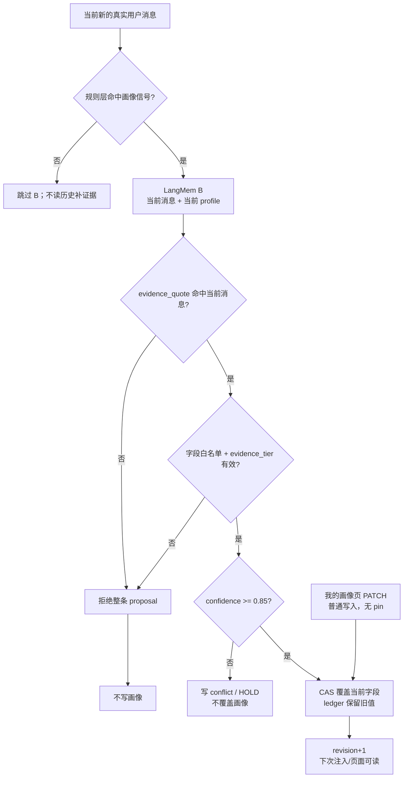
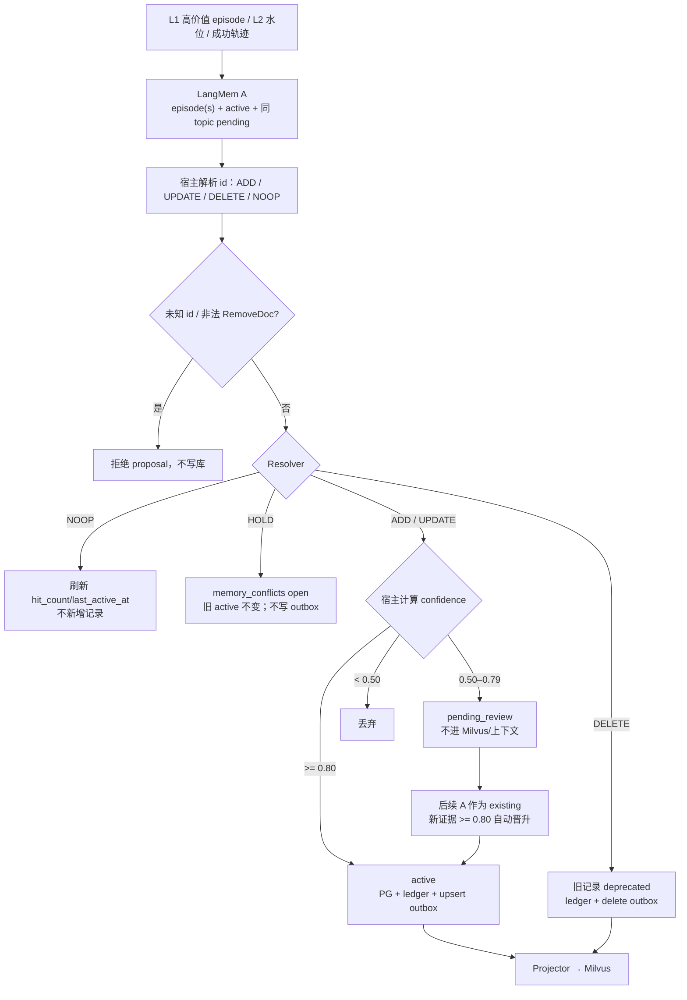
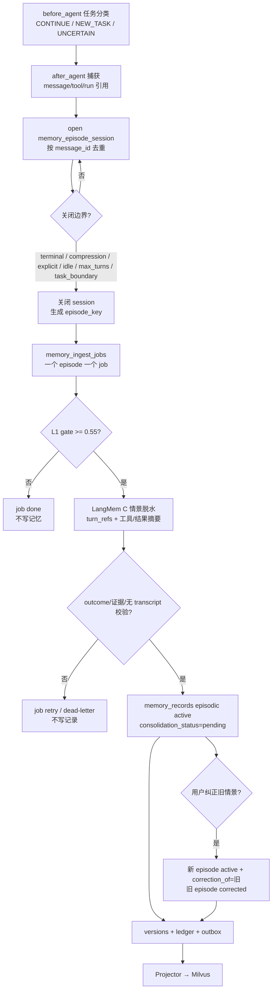
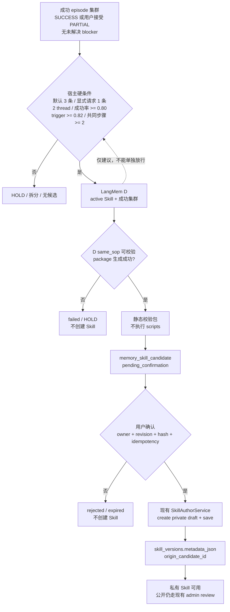

# Agent 记忆模块设计（Milvus + Skill 确认版）

> 状态：评审稿（设计阶段，未实施）
> 日期：2026-10-26
> 主参考：[ai_agent.md](ai_agent.md)
> 结合参考：
>
> - [长期记忆模块设计（上一版）](2026-10-25-long-term-memory-module-design.md)
> - [技能包 Git 发布、私有创作与审核设计](../superpowers/specs/2026-10-23-skill-package-git-release-design.md)
> - [知识库功能方案（MinerU + Milvus）](2026-10-22-knowledge-base-design.md)
> - [LangMem 无状态认知算子设计](langmem_ai_agent.md)
>
> 修订（2026-10-26）：情景记忆增加 episode session 缓冲；画像改为对话中直接写入并新增“我的画像”页面；语义事实按证据置信度阈值自动激活；四类提取统一使用 LangMem 无状态认知算子。LangMem 实现取最新稳定版并在锁文件中精确锁定；四类算子统一使用 agent 配置的默认模型，不单独配置 memory 模型。
>
> 本文是新的主设计，不覆盖上一版历史文档。优先级如下：
>
> 1. ai_agent.md 的记忆架构作为主干；
> 2. 用户明确约束覆盖主干中的实现选择：向量库使用 Milvus；程序性记忆必须由用户在前端确认；技能生命周期使用现有技能管理设计；
> 3. 现有记忆实现和上一版设计用于补齐画像、隔离、删除、接口和迁移细节；
> 4. 与现有技能设计冲突时，以现有技能设计为准，记忆模块不得另造一套 Skill 生命周期；
> 5. 四类提取以 langmem_ai_agent.md 的无状态算子 A/B/C/D 和 EvidenceTier 为基准；持久化治理以本文的 PostgreSQL + Milvus 控制面为准。

## 0. 结论摘要

这套设计把“记忆”分成四个产品对象，技术上分为常驻、检索、程序、提取四层：

| 层次 | 内容 | 存储与检索 |
|---|---|---|
| 常驻层 | 用户画像 | PostgreSQL 单例；不走向量；按预算注入 |
| 检索层 | 语义事实、情景记忆 | PostgreSQL 权威记录 + Milvus 活跃投影；按需检索 |
| 程序层 | 程序性记忆（Skill） | PostgreSQL 候选 + Git/技能库；用户确认后交给现有技能系统 |
| 提取层 | 四类记忆的认知提取 | LangMem 无状态算子 A/B/C/D；不绑定任何存储 |

核心判断：

1. PostgreSQL 是唯一权威存储，Milvus 只是可重建的活跃向量投影。删除、冲突、审批和审计不能只存在于 Milvus。
2. 语义事实和情景记忆进入 Milvus；画像和程序性候选不进入记忆向量集合。画像按用户直接读取；程序性记忆在用户确认后进入现有技能系统的 Milvus 投影。
3. 程序性记忆绝不自动变成 Skill。后台最多生成“技能候选”，用户在现有前端技能工作台确认后，才通过现有技能服务创建私有技能；公开分享继续走现有管理员审核。
4. 情景记忆只存脱水摘要和证据引用，不存原始 transcript，也不引入 S3/MinIO。原始消息/工具结果仍由 run/checkpoint/工件层负责。
5. 记忆抽取异步化，主对话链路不做记忆抽取 LLM；仅任务分类器在 before_agent 做一次受约束的边界分类并生成新任务的 task_goal（task_goal 为空时强制 NEW_TASK）。使用 PostgreSQL 任务表 + SKIP LOCKED 抢占；Redis Stream 只在吞吐确实需要时作为可选传输，不作为正确性依赖。
6. 检索使用 Milvus 稠密召回 + PostgreSQL 词法召回，再由 PostgreSQL 确认、重排。这保留了 ai_agent.md 的混合检索思想，同时避免把正文和权限判断交给 Milvus。
7. memory_search 只检索语义/情景；程序性记忆由现有技能路由检索，记忆模块不重复索引 Skill 正文。
8. 情景记忆按 session 缓冲，到任务终态/压缩/显式总结或任务分类器判 NEW_TASK 才关闭并生成一个 episode；不在每轮对话后直接抽取。
9. 画像在对话中由 LangMem Profile 算子直接写入；用户可在导航栏“我的画像”页面查看和修改。
10. 语义事实的置信度由证据等级确定性计算；达到阈值自动 active，低于阈值进入 pending_review，不默认注入。
11. 四类提取都使用 LangMem 的无状态认知算子；LangMem 不持有 store、不直接写 PG/Milvus，写库由本系统控制面完成。
12. 每个新用户消息先由任务分类器判定 CONTINUE / NEW_TASK / UNCERTAIN，并在 NEW_TASK 时生成 task_goal；task_goal 为空强制 NEW_TASK；task_id 只由宿主代码生成，模型不生成 ID，客户端不能指定 task_goal/task_id。

一句话：记忆模块负责“记住什么、何时想起、如何溯源”；技能模块负责“如何执行、如何审核、如何发布”。两者通过“用户确认”这一个明确动作交接。

## 1. 内容审查与取舍

### 1.1 ai_agent.md 中保留的主干

以下结论直接沿用其架构意图，不改变语义：

- 三类认知记忆：情景记忆是经验来源，语义记忆是去情景化知识，程序性记忆是固化后的可复用做法。
- 情景记忆的三道门：写入门控、边界分割、读取/注入门控。
- 后台异步蒸馏：L1 事件驱动、L2 水位线/聚类驱动、L3 定时批处理。
- 冲突消解：NOOP / ADD / UPDATE / DELETE，加上 scope_condition，避免跨作用域误覆盖。
- 程序性记忆必须人工确认后才能生效，不能自动上线。
- 事件溯源/变更台账、双时态字段、乐观锁、可回滚。
- 艾宾浩斯式衰减、热/温/冷分层和混合检索重排。
- 计算与存储解耦：LangMem 只做无状态认知提取，存储治理由 PostgreSQL + Milvus 控制面负责。

### 1.2 必须针对本仓库修改的部分

| 编号 | ai_agent.md 的选择 | 本文调整 | 原因 |
|---|---|---|---|
| A1 | PostgreSQL + pgvector，嵌入存在 memory_nodes | PostgreSQL 只存权威记录；Milvus 存活跃向量投影 | 用户明确要求 Milvus；同时避免把事务、删除和审批押在向量库上 |
| A2 | 程序性记忆直接写入 memory_nodes，DRAFT 等待审核 | 记忆侧只产生 skill_candidate；用户在现有技能工作台确认后，由现有技能服务创建私有 Skill | 用户要求前端确认；现有技能设计已经拥有 Skill/Git/审核/Milvus 生命周期 |
| A3 | Skill 内容存在 memory_nodes | 正式 Skill 正文只存在 Git/现有技能库；记忆候选表可暂存提案快照，用户确认后以 Skill 版本为准，候选只保留 diff/验证/链接 | 防止两套 Skill 真相、两套权限、两套发布 |
| A4 | 原始工具输出转存 S3/MinIO，记忆保留 raw_payload_ref | 不新增对象存储；情景只保留证据引用（message/tool_call/run_event ID） | 不扩大基础设施；原始数据仍由现有 run/工件层保存 |
| A5 | Redis Stream 承担事件总线 | 正确性用 PostgreSQL 任务表/outbox；Redis 仅可选加速 | 少一个强依赖；任务、审计、outbox 可以同事务提交 |
| A6 | 管理员审核台是 Skill 晋升主界面 | 用户确认是程序性记忆的必经门；管理员审核仅用于“公开技能” | 用户要求；现有技能设计已经把私有与公共审核分开 |
| A7 | 语义记忆包含用户画像 | 画像独立为有界单例 schema，不参与语义冲突仲裁 | 现有产品需要画像常驻、字段级墓碑、可审计来源/证据等级和独立编辑页；不能让画像变成无界 facts |
| A8 | 情景记忆保存完整交互轨迹 | 只保存脱水摘要、环境前提、结果、关键反思和证据引用 | 控制成本/隐私/提示注入；原始轨迹由 run 层保留 |
| A9 | 自动沙箱回放验证 Skill | v1 使用现有技能包的静态校验 + 用户人工确认；回放作为可选增强，不作为发布前置 | 现有技能设计 V1 的信任边界是人工审核，且不执行用户脚本 |
| A10 | HNSW 建立在 PostgreSQL 局部索引 | HNSW/AUTOINDEX 建立在 Milvus collection；PG 只做命中确认 | 用户要求 Milvus；避免 PG 向量扩展成为硬依赖 |
| A11 | 记忆提取由单次自定义 Prompt/模型完成 | 四类提取统一使用 LangMem 无状态算子 A/B/C/D；取最新稳定版并锁版本；模型继承 agent 默认模型；宿主只做解析、校验、写库 | 用户要求；复用 LangMem 的 schema 校验和反思能力，同时保留自有存储治理 |
| A12 | 情景按每轮对话切分 | 增加 memory_episode_sessions 缓冲，到任务终态/压缩/显式总结才关闭并生成 episode | 避免长任务被切碎，也让 L1 价值门在正确的粒度上计算 |
| A13 | 画像只接受显式/手动/确认，或把画像完全交给语义记忆 | 对话中由 LangMem Profile 算子直接写；前端新增“我的画像”页；低证据不写、冲突 HOLD | 用户要求画像可直接提取；同时保留字段白名单、证据和冲突保护 |

### 1.3 与上一版记忆设计的关系

上一版解决的是“先把画像和语义事实做稳”：有界画像、事实检索、冲突、墓碑、维护、API。新设计保留这些边界，但做三个升级：

1. 存储从 LangGraph BaseStore 收敛到“PostgreSQL 权威 + Milvus 投影”；BaseStore 只作为迁移期兼容读。
2. 写入从进程内 debounce 升级为持久任务/水位/重试；不把最后一批记忆交给进程内存。
3. 程序性记忆不再只是“预留类型”，而是进入“候选 → 用户确认 → 现有技能系统”的完整链路。

画像仍然是独立对象，不因为 ai_agent.md 把它归入语义记忆就放弃有界 schema。认知分类可以合并，工程权限不能合并。

### 1.4 设计原则

- 单一权威：PostgreSQL 决定一条记忆是否存在、是否可见；Milvus 只回答“可能相关”。
- 用户确认：程序性记忆从候选变成 Skill，必须有可审计的用户确认事件。
- 不复制 Skill：正式 Skill 内容只有一个来源（Git/技能库）；记忆只保留候选快照、diff、验证和链接，确认后以 Skill 版本为准。
- 先证据后生成：情景必须能指向真实消息/工具调用/运行结果；没有证据的摘要不进入长期库。
- 无状态算子：LangMem 不持有数据库连接、不调用 BaseStore、不直接写记忆；它只接收输入并返回结构化结果。
- 证据定级：置信度从 evidence_tier 和 evidence_quote 计算，不接受模型随意给的浮点 confidence 作为最终真值。
- 按需注入：画像常驻但有界；事实和情景默认不注入，由检索门控决定。
- 可删除、可回滚：墓碑、epoch、变更台账、Skill 下架/回滚都要能解释“删了什么、为什么、影响了谁”。
- 能力降级：Milvus 不可用时仍能写入 PG、仍能走词法检索；不能因为向量库故障让对话失败。
- 默认关闭：记忆写入、自动蒸馏、技能候选生成分别有开关，先 shadow 再启用。

## 2. 范围与边界

### 2.1 目标

1. 跨 thread 记住稳定画像、项目事实、重要经历和可复用做法。
2. 用情景轨迹提升后续任务的成功率，而不是把全部聊天记录塞进上下文。
3. 让每条长期记忆可追溯到证据、可解释冲突、可由用户删除/导出。
4. 程序性记忆以 Skill 形态进入现有技能工作台；用户确认后才可用，公开分享仍走现有审核。
5. 在 PostgreSQL + Milvus 上支持多用户隔离、热/温/冷分层和可重建索引。

### 2.2 非目标

- 不把记忆库做成完整事件日志仓库；原始 transcript/工具输出仍归 run/checkpoint/工件层。
- 不自动创建、自动启用或自动公开发布 Skill。
- 不另建一套 Skill 编辑器、审核队列或 Git 发布流程。
- 不让 Milvus 成为记忆正文、权限或审批状态的权威来源。
- 不做团队/组织/跨租户共享记忆（本期仍 user 级）。
- 不做通用知识图谱；语义事实先以原子记录和 topic/scope 为主。
- 不承诺对 tool result、多模态、上传文件和 artifact 做全面 PII 识别。

### 2.3 与相邻模块的边界

| 模块 | 负责 | 不负责 |
|---|---|---|
| 记忆模块 | 画像、语义事实、情景摘要、技能候选、冲突、淘汰、记忆检索 | 执行 Skill、发布 Skill、保存原始轨迹 |
| 技能模块（现有设计） | Skill 包/Git/版本/私有与公共审核/Milvus 技能投影/运行时注入 | 从对话中发现技能候选、决定记忆事实 |
| Run/Checkpoint/工件 | 原始消息、工具结果、运行状态、可回放证据 | 长期语义归纳 |
| 知识库 | 公共文档与领域知识 | 用户个人偏好/经历 |
| 前端技能工作台 | 用户私有 Skill 的创建、编辑、保存、提交、审核状态 | 训练记忆模型或决定事实冲突 |

## 3. 四类记忆与职责

| 类型 | 认知问题 | 存储 | 检索 | 生命周期 |
|---|---|---|---|---|
| 画像 profile | 用户稳定、可枚举的属性是什么？ | PostgreSQL 单例 + 字段墓碑 | 每次会话按预算注入 | 字段级更新；不归档、不折叠、不走向量 |
| 语义 semantic | 哪些去情景化事实/偏好值得以后查？ | PostgreSQL 记录 + Milvus 活跃投影 | 按需检索、冲突仲裁 | active / pending_review / expired / superseded / folded / dormant / archived / deleted / conflicted / deprecated / rolled_back |
| 情景 episodic | 过去发生了什么、为什么、结果如何？ | PostgreSQL 记录 + Milvus 活跃投影 | 按时间/主题/环境检索；按门控注入 | active / dormant / archived / corrected / deleted；纠正是新事件，旧事件标 corrected |
| 程序性 procedural | 哪些做法可复用、适用条件和例外是什么？ | PostgreSQL 候选 + 现有技能系统（Git/技能库） | 现有技能路由；记忆不重复索引 | proposed / validating / pending_confirmation / creating / confirmed_draft / saved / failed / rejected / expired；确认后进入技能生命周期 |

程序性记忆的特别说明：它不是“第四套存储”，而是“技能候选 + 现有 Skill 系统”。记忆模块负责从情景里发现候选、生成 diff、展示来源、等待用户确认；用户确认后，实际 Skill 由现有技能服务创建、保存、检索和审核。这样既满足“程序性记忆可演进”，又不会绕过现有技能治理。程序性记忆的检索入口是现有技能路由（search_and_load_skills / active skills），不是 memory_search；记忆模块不重复索引 Skill 正文。

### 3.1 最小载荷与硬边界

| 类型 | 最小载荷 | 明确不允许 |
|---|---|---|
| profile | 有界字段值、source、evidence_tier、confidence、observed_at/confirmed_at、字段墓碑 | 自由文本 notes、法定姓名/证件/凭据、低证据推断、无证据值 |
| semantic | content、topic_key、scope_condition、source、evidence_tier、confidence、valid_from/to、hit_count/last_active_at | 无证据推断、跨 scope 的全局覆盖、原始工具输出 |
| episodic | task_intent、environment preconditions、trajectory_digest、final_outcome、key_takeaway、feedback、salience、is_skill_candidate、证据引用 | 原始 transcript、完整工具输出、未脱敏 PII、本地绝对路径 |
| procedural candidate | private_name、trigger、不可变 package_snapshot（SKILL.md + 文件清单/hash）、package_sha256、base_skill_version_id、diff、validation_report、source_episode_ids、skill_id/version_id（确认后） | 自动 active、自动公开、自动执行脚本、绕过现有技能审核 |

冷启动（Day 0）：使用现有公共技能目录、已有画像和已有语义事实，不伪造情景/技能；Day 1+ 才通过情景蒸馏增长。画像字段仍按上一版的有界分组（身份/沟通/工作/无障碍/边界）。对话抽取可以直接写画像，但必须带 evidence_tier/evidence_quote，并经过字段白名单、证据阈值、权威和 CAS 校验；手动设置和“我的画像”页面的修改始终可用。profile 的每个字段是 {value, source, evidence_tier, confidence, observed_at, confirmed_at, tombstoned_at}，整份 profile 带 revision；source 允许 user_manual、user_explicit_durable、user_confirmed、conversation_extracted；conversation_extracted 必须带 evidence_tier/quote 且达到阈值；不允许自由文本 notes。

## 4. 总体架构

~~~text
对话热路径
  before_agent: 任务分类 → 读取画像 → 注入
  after_agent: 追加 memory_episode_sessions（不抽取）
  episode 关闭: L0/L1 → memory_ingest_jobs

后台控制面
  LangMem A/B/C/D（无状态，返回 proposal）
    → 宿主 evidence/阈值/权威校验
    → PostgreSQL 事务 + memory_record_versions + ledger + outbox
    → Projector → Milvus myflow_memory_active

程序性支路
  LangMem D → memory_skill_candidates
    → 用户“我的技能/记忆建议”确认
    → 现有技能服务（Git/PG/myflow_skills_active）
    → 公开分享走现有 admin review
~~~

### 4.1 为什么权威库与向量库分离

- 记忆需要事务：冲突替换、删除/墓碑、用户确认 Skill、索引 outbox 必须一起提交。
- 记忆需要精确过滤：user_id、kind、status、valid_to、approval；向量库只适合做候选召回。
- 记忆需要可重建：Milvus collection 可以删除重建，不能承载唯一的正文和审批状态。
- 记忆需要可降级：Milvus 故障时仍能读写 PostgreSQL，走词法检索；对话不崩。
- 记忆需要审计：变更台账、复核、删除原因在 PG；Milvus 不承担审计。

### 4.2 组件职责

| 组件 | 负责 | 不负责 |
|---|---|---|
| Capture | 识别真实用户消息/最终可见回复/结果状态；追加 episode session，关闭后写 job | 语义判断、模型抽取 |
| Task Classifier | 新用户消息到达时判断 CONTINUE/NEW_TASK/UNCERTAIN，NEW_TASK 时生成 task_goal；只写 task_context 和边界事件 | 生成 task_id、写记忆、直接关闭 session |
| Gate | 规则过滤、惊奇度/反馈/复杂度、边界切分 | 写记忆 |
| LangMem Operator Layer | A 语义事实、B 画像、C 情景脱水、D 技能优化；输出结构化 proposal | 持有 store、直接改 PG/Milvus、直接创建 Skill |
| Resolver | 按 kind/scope/authority 决定 NOOP/ADD/UPDATE/DELETE/HOLD | 自由裁量事实真假 |
| Repository | PostgreSQL 事务、CAS、墓碑、outbox、审计 | 向量计算 |
| Projector | 消费 outbox，upsert/delete Milvus 行；对账 | 决定记忆状态 |
| Retriever | Milvus 稠密 + PG 词法 + PG 确认 + 重排 | 越过用户/status 过滤 |
| Skill Bridge | 候选展示、用户确认、调用现有技能服务 | 另建 Skill 状态机/审核 |
| Maintenance | 冷热、折叠、过期、候选提醒 | 自动批准 Skill |

### 4.2.1 LangMem 无状态认知算子层

四类提取统一走 LangMem 算子；LangMem 是**计算层**，不是存储层。

| 算子 | LangMem 原语 | 输入 | 输出 | 宿主动作 |
|---|---|---|---|---|
| A 语义事实 | create_memory_manager，启用 insert/update/delete | 当前可见对话 + 召回的 existing 事实 | ExtractedMemory 列表（含 Add/Update/Remove） | 解析为 NOOP/ADD/UPDATE/DELETE/HOLD；阈值判断后写 PG |
| B 画像 | create_memory_manager，insert=False，update=True | 当前对话 + 当前 profile（宿主先确保空 profile 记录存在） | ProfilePatch（固定字段槽位） | 白名单/证据/阈值/CAS 校验后直接写 profile；冲突 HOLD；不产生第二个 profile |
| C 情景脱水 | create_memory_manager，insert=True，update=False | 关闭后的 episode session 轮次 | DehydratedEpisode | 追加 episodic；不覆盖历史 |
| D 技能优化 | create_prompt_optimizer(kind=gradient) | 现行 active Skill + 成功 episode 集群 | Skill Markdown/包草案 + diff | 生成 skill_candidate；用户前端确认后才创建 Skill |

硬约束：

- 禁止使用绑定数据库的 create_memory_store_manager；禁止让 LangMem 直接读写 BaseStore/PG/Milvus。
- 算子只返回结构化数据，不返回“已写库”的结果；Repository 是唯一写入口。
- 算子输出必须带 evidence_tier、evidence_quote、source id；宿主重新计算 confidence，不信任模型自报浮点。
- LangMem 不可用或版本不兼容时，抽取功能关闭并告警；不能悄悄退回手写 Prompt 提取。
- 模块只依赖 LangMem 的无状态原语；实现时安装最新稳定版，并把精确版本写入 uv.lock；升级走单独 PR + A/B/C/D 契约测试。
- 模型统一从 agent 配置解析：AppConfig.agents.default_model（未设置时用 models[0]），通过 create_chat_model(name=..., thinking_enabled=False, attach_tracing=False, app_config=...) 构建；不设置独立的 memory model，也不因某次 run 选择了别的模型而改变记忆蒸馏模型。
- 如果 agent 默认模型不支持 LangMem 所需的 structured output/tool calling，四类提取关闭并告警，不降级到手写 Prompt。

证据等级与宿主计算的初始 confidence：

| evidence_tier | 含义 | 初始 confidence |
|---|---|---|
| EXPLICIT_MANDATE | 用户显式立规矩/强指令 | 0.95 |
| EXPLICIT_STATEMENT | 用户客观陈述事实/偏好 | 0.85 |
| BEHAVIORAL_OBSERVED | 从执行轨迹观察到的习惯 | 0.70 |
| INFERRED_HYPOTHESIS | 单次弱推断 | 0.50 |

- 语义事实：confidence >= 0.80 自动 active；0.50–0.79 进 pending_review；低于 0.50 或证据不完整不落库。
- 画像：confidence >= 0.85 才允许对话直写；低于阈值不写画像，可降级为语义 pending_review 或丢弃。
- 模型只给 evidence_tier/quote，后端映射 confidence；不要让模型直接给 0.97 这样的浮点。

## 5. 存储模型

### 5.1 PostgreSQL 表

表名是建议名，迁移时可映射现有表；核心是权威字段，不是具体 DDL。

| 表 | 关键字段 | 用途 |
|---|---|---|
| memory_profiles | user_id PK、schema_version、revision、profile JSONB、tombstones JSONB、updated_at | 画像单例；profile 字段含 value/source/evidence_tier/confidence/observed_at/confirmed_at；字段级墓碑；CAS |
| memory_records | id UUID、user_id、kind、subtype、status、revision、content、payload JSONB、topic_key、scope_condition、source、evidence_tier、confidence、consolidation_status、consolidated_at、salience、hit_count、last_active_at、explicit_remember、parent_memory_id、correction_of、valid_from、valid_to、occurred_at、task_id、thread_id、agent_name、provenance JSONB、source_episode_ids、archived_at、deleted_at、created_at、updated_at | 语义/情景的物化当前态；episodic 用 consolidation_status/consolidated_at 防重复 L2；只保存当前指针，不覆盖历史；explicit_remember 仅用于语义保护，不是画像 pin |
| memory_record_versions | memory_id UUID、user_id、revision、status、content、payload JSONB、valid_from、valid_to、changed_at | 追加式版本快照；按用户隔离；回滚/审计/双时态 |
| memory_skill_candidates | id UUID、user_id、status、revision、private_name、description、trigger_text、package_snapshot JSONB、package_sha256、skill_md_sha256、base_skill_version_id、diff_patch、validation_report JSONB、source_episode_ids、origin_idempotency_key、skill_id、skill_version_id、confirmed_by/at、rejected_reason、created_at、updated_at | 不可变候选包快照；等待用户确认；不进入模型检索 |
| memory_conflicts | id UUID、user_id、kind、field_path/topic_key、current_record_id、candidate_record_id、current_snapshot JSONB、candidate_snapshot JSONB、status、evidence_refs、created_at、resolved_at | 未消解冲突；画像/语义候选都必须有快照 |
| memory_scope_meta | user_id PK、cleared_at、epoch、updated_at | 清空/忘记水位；防止旧任务复活 |
| memory_episode_sessions | id UUID、user_id、thread_id、task_id、task_goal、task_goal_source、status、open_turn_id、last_turn_id、episode_key、turn_refs JSONB、boundary_decision、boundary_uncertain、last_activity_at、closed_at、close_reason、created_at、updated_at | 情景缓冲；同一 thread 同时最多一个 open session；task_id 由代码生成，task_goal 由分类器/fallback 生成，为空表示尚未开始任务 |
| memory_ingest_jobs | id、user_id、thread_id、episode_session_id、episode_key、job_type、status、lease_until、attempts、payload JSONB（含 task_id/turn_refs）、created_at | 持久捕获任务；episode 关闭后入队；SKIP LOCKED |
| memory_consolidation_jobs | id、user_id、source_episode_ids、kind_target、status、lease_until、attempts、result_ref、created_at | 蒸馏/聚类/技能候选任务 |
| memory_mutation_ledger | tx_id、user_id、actor_type、actor_id、op_type、before_id、after_id、before_revision、after_revision、before_status、after_status、op_json、inverse_json、rollback_of、source_episode_ids、reason、created_at | 追加式变更台账；按用户隔离；支持回滚和合规 |
| memory_index_outbox | id、user_id、pk、memory_id、op、revision、epoch、state、attempts、next_attempt_at、last_error、created_at、updated_at | PostgreSQL → Milvus 的可靠投影；pk/epoch 支持物理删除和 fencing |
| memory_projection_state | collection、embedding_model、dimensions、schema_version、last_reconciled_at | 索引版本/对账 |

约束：

- memory_profiles 每个 user 一行；profile revision 是乐观锁。
- memory_records 的 (user_id, id) 唯一；每次变更同时追加 memory_record_versions（(memory_id, revision) 唯一）；当前表只做指针，不覆盖历史。
- 语义事实以 user_id + topic_key + 规范化内容做幂等键；情景以 user_id + thread_id + episode_key 做幂等键；情景纠正用 correction_of，不覆盖旧行，并用部分唯一索引保证同一 target 只有一个 active 纠正。
- memory_episode_sessions 对 (user_id, thread_id) 建部分唯一索引，status=open 时最多一个；关闭后写 episode_key 并入队。task_id 在同一 thread 内标识任务；task_id 只由宿主代码生成，task_goal 由分类器生成但必须经宿主校验后写入；客户端不得指定 task_id/task_goal。
- NEW_TASK 先关闭旧 session（close_reason=task_boundary）并只入队一次，再为新 task_id 追加消息；UNCERTAIN 不关闭 session，只记录 boundary_uncertain。
- episodic 的 consolidation_status 取 pending/locked/done/error；L2 只能领取 pending，成功后写 done/consolidated_at，避免重复蒸馏。
- semantic 的 pending_review 不写 Milvus、不注入；confidence 达到 auto_activate_threshold 才转 active。
- memory_ingest_jobs.payload 只允许消息/工具调用/运行结果引用和摘要，不允许原始 transcript/完整工具输出。
- 所有可见性由 status + valid_to + deleted_at 决定；Milvus 命中后必须回 PG 再确认。
- 只有 active 且未删除的 semantic/episodic 才写 outbox 的 upsert；pending_review/conflicted 及其他非 active 状态写 delete。
- outbox 行必须带 user_id、pk、epoch；consumer 应用前重读 PG 当前 revision/status/epoch，旧事件直接跳过。
- 影响投影的字段（status、valid_to、last_active_at、salience、explicit_remember）变化都要入 outbox；物理删除用 epoch + pk 生成 delete，不能依赖 PG 行还存在。
- memory_skill_candidates 与现有 skills 表通过 skill_id/version_id 关联；不复制 Skill 正文到 Skill 表之外的另一张“技能表”。

### 5.2 状态机

| 类型 | 允许状态 |
|---|---|
| profile | 字段 active / tombstoned；整个 profile 不归档 |
| semantic | active、pending_review、expired、superseded、folded、dormant、archived、deleted、conflicted、deprecated、rolled_back |
| episodic | active、dormant、archived、corrected、deleted；纠正是新记录（correction_of），旧记录标 corrected，不覆盖内容 |
| skill_candidate | proposed、validating、pending_confirmation、creating、confirmed_draft、saved、failed、rejected、expired |
| 现有 Skill | 沿用现有技能设计：draft、pending、approved、rejected、withdrawn、superseded、public/private active 等 |

约束：

- dormant 是“移出向量索引但保留深检索/恢复”的温层；archived 是冷层；二者都不默认注入。
- deleted 只表示用户删除/墓碑；物理清理由保留期任务执行。
- conflicted 只表示候选不可见；当前 active 值仍然可检索。
- rolled_back 用于按变更台账回滚后的旧节点，保留审计。
- 情景没有 supersede；纠正是新 episodic，带 correction_of，旧记录标 corrected；不覆盖旧内容。
- pending_review = 语义候选已落库但置信度未达阈值，只有 owner promote 后才 active；它不是默认可见记忆。
- 状态语义：superseded = 被新版本替代；corrected = 被新情景纠正；deprecated = 用户/规则明确废弃且无替代；rolled_back = 用历史 revision 恢复后，被替换的当前版本；folded = 已合并；conflicted = 候选不可见。
- correction_of 必须指向同一 user/kind、未删除的情景；同一 target 只能有一个 active 纠正；旧 event 默认不再注入。
- superseded/deprecated/rolled_back/folded/corrected 都是历史态，不作为“当前 active”；回滚产生新的 active revision，不把旧行原地改回。folded 是终态；需要恢复时按 source_record_ids 重建，不原地翻回。
- 允许转移：active → superseded/deprecated/folded/dormant/archived/deleted/rolled_back；pending_review → active/expired/deleted；dormant → active/archived/deleted；archived → active/deleted；历史态不直接回 active，只能通过 rollback/restore 产生新 revision。
- 技能候选的 confirmed_draft/saved 不等于 Skill 已公开；它只表示用户同意交给技能系统。

容易混淆的状态：

| 名称 | 所属对象 | 可见性 | 含义 |
|---|---|---|---|
| pending_review | semantic record | 待确认页/API + 后台 A existing 候选；不进 Milvus、不注入 | 低置信事实待 owner 确认，可被后续证据晋升或过期 |
| pending_confirmation | skill_candidate | 仅技能工作台候选区 | Skill 包待用户确认，尚未创建 Skill |
| consolidation_status=pending | episodic record/job | 后台队列 | 情景尚未被 L2 蒸馏，不是用户可见状态 |
| conflicted | semantic/profile candidate | 前端冲突页 | 与 active 旧值矛盾，HOLD |
| corrected | episodic record | 历史/审计 | 已被新情景纠正 |

### 5.3 Milvus collection

collection 建议名：myflow_memory_active。它是一张可重建的活跃投影，不是版本库。

| 字段 | 类型 | 用途 |
|---|---|---|
| pk | VARCHAR | user_id + ":" + memory_id；主键 |
| user_id | VARCHAR | 强制过滤；标量索引 |
| memory_id | VARCHAR | 回 PG 确认 |
| kind | VARCHAR | semantic / episodic；标量索引 |
| status | VARCHAR | 只写 active；标量索引；防御旧行 |
| topic_key | VARCHAR | 调试/过滤 |
| scope_condition | VARCHAR | 作用域过滤/展示 |
| valid_from / valid_to | INT64 | 秒级时间戳；valid_to=0 表示当前有效 |
| occurred_at | INT64 | 情景时间；语义可为 0 |
| confidence | FLOAT | 证据置信度；active 也保留，便于诊断/阈值过滤 |
| salience | FLOAT | 排序特征 |
| last_active_at | INT64 | 衰减重排 |
| explicit_remember | BOOL | 语义保护标记；画像不使用 pin |
| indexed_revision | INT64 | 与 PG revision 对齐 |
| embedding | FLOAT_VECTOR | 维度由 embedding 配置决定 |
| embedding_model / embedding_dimensions | VARCHAR / INT | 漂移检测 |
| updated_at | INT64 | 投影时间 |

明确不写入：

- 画像（直接读 PG，不走向量）。
- 技能候选（未确认，不可检索）。
- 已确认的 Skill 正文（由现有 myflow_skills_active 管理）。
- superseded / folded / dormant / archived / deleted / conflicted 记录（删除或移出投影）。
- 原始 transcript、工具输出、附件正文。

检索过滤必须在召回前下推：

- 不把 user_id 只放在应用层再过滤；Milvus 查询表达式必须包含它。
- 如果未来使用 hybrid_search，filter 必须放进每个 AnnSearchRequest 的 expr；不能只写在顶层（现有知识库设计已经踩过这个坑）。
- 命中后必须按 memory_id + user_id + revision 回 PostgreSQL 确认；Milvus 旧行、伪造行、跨用户行一律丢弃。
- consistency_level 默认 Strong；outbox 完成后，下一次检索应尽量读到新投影。
- collection 维度固定；换 embedding 模型/维度必须新建 collection 并重建，不做原地混写。

### 5.4 Milvus 索引与容量

- 向量索引：HNSW 或 AUTOINDEX，metric_type=COSINE；参数走配置，不硬编码。
- 标量索引：user_id、kind、status、valid_to；confidence 可作为可选索引；必要时对 topic_key 建索引。
- 召回上限 candidate_k（如 50）；应用层按用户/kind 配额截断。
- 不为每个用户建 collection；user_id 过滤 + 标量索引足够。数据量很大时再评估 partition key / 分片，但权限仍以 PG 为准。
- 不为每个 kind 建 collection；kind 作为过滤字段，便于统一 outbox 和重建。
- 定期对账：PG active 集合 vs Milvus pk 集合；缺行补、脏行删、维度不符报警。
- 全量重建：POST /api/memory/reindex 按 PG active 重建 collection，删除孤儿行；consumer 按 revision/epoch fencing，乱序 delete/upsert 不能复活旧行。

## 6. 写入链路

### 6.1 热路径只捕获，不抽取

新消息到达时，`before_agent` 先运行任务分类器；它产出 `decision + task_goal`，不写记忆、不生成 task_id。task_goal 为空时强制 NEW_TASK，并仍由分类器生成新任务目标；分类器不可用才使用代码 fallback。只有 NEW_TASK 才因任务边界关闭旧 session 并切换到新 task_id，UNCERTAIN 默认不切。分类器细节见 §6.3.1。

after_agent / turn finalizer 不再每轮直接写“抽取 job”，而是把本轮追加到情景 session：

1. 按 user_id + thread_id 找 open 的 memory_episode_sessions；
2. 追加真实用户消息/最终可见回复的引用、工具调用摘要、run 结果、时间；同一 message_id 只追加一次；
3. 更新 last_activity_at；不调用 LLM，不写 Milvus；
4. 到边界时关闭 session，生成 episode_key，并写 memory_ingest_jobs。

异常/取消/超时路径由 executor 的 finally 兜底；正常路径和兜底路径使用同一个 session/episode 幂等键。显式“记住/忘记”走 before_agent 快路径，先落 instruction/墓碑；显式“记住这次”同时立即关闭 session。

压缩钩子只补充尚未被 open/closed session 覆盖的 message_id；不得把旧 checkpoint 整体重放给 LangMem。已关闭 session 的 episode_key 和已处理 message_id 是重放边界。

### 6.2 三级门控

L0 规则门（0 Token）

- 纯寒暄、简单确认、无信息增量的只读查询：丢弃。
- 凭据、密钥、完整证件号/卡号：拒绝。
- 任务级临时参数（“这次用三行”）：不写画像；是否作为情景由规则决定。
- 纯问题、假设、提议、未采纳方案：不作为承诺写入。
- 没有跨会话价值：跳过。

L1 价值门（可规则 + 轻量模型）

在 episode 关闭时对整段 session 计算写入门控分，取最大值：

- 惊奇度：工具报错、重试修复、进入 fallback、用户打断/纠正；
- 反馈度：用户明确赞赏、否定、纠正、手动修改；
- 复杂度：多工具链、多子代理、长任务、关键决策。

达到阈值才进入 LangMem 情景脱水。阈值按标注集校准，不把示例值当生产规则。

L2 脱水门

- 去掉大段原始工具输出/日志/HTML/长 JSON；只保留“状态码 + 关键指标/异常特征 + 证据引用”。
- 情景摘要包含：意图、环境前提、关键步骤/决策、最终结果、失败与修复、用户反馈、可复用线索。
- 超过预算的原文不进入记忆；引用 run_event_id / message_id / tool_call_id 作为证据。
- 不引入 S3/MinIO；原文的去留由现有 run/工件层负责。

### 6.3 情景边界与 session 缓冲

当前方案不是让模型自由生成 session，也不是让模型自由决定“在哪里切”，而是**确定性规则 + 受限任务分类器**：

1. **确定性边界优先**：Agent 终态、子任务完成/失败/被中止、压缩钩子、用户显式“记住这次/总结一下”。
2. **任务分类器**：新用户消息到达时输出 CONTINUE / NEW_TASK / UNCERTAIN，并在 NEW_TASK 时生成 task_goal；task_goal 为空强制 NEW_TASK；只有 NEW_TASK 才切任务，UNCERTAIN 默认不切。
3. **可选语义漂移**：滑窗向量相似度下降、话题词变化时开新 session；v1 只作为增强，不作为唯一依据。
4. **session 缓冲**：after_agent 只追加轮次，不立即抽取；边界关闭时才生成 episode。

| 字段 | 作用 |
|---|---|
| id | session 主键 |
| user_id/thread_id | 用户/会话隔离 |
| task_id | 当前任务；由宿主代码生成，模型/客户端不可指定 |
| task_goal | 当前任务目标；空表示尚未开始任务 |
| open_turn_id/last_turn_id | 起止轮次 |
| turn_refs JSONB | 仅保存消息/工具调用/run 引用，不复制原始正文 |
| status | open / closed / locked / swept |
| boundary_decision | CONTINUE / NEW_TASK / UNCERTAIN；记录最近一次分类结果 |
| boundary_uncertain | UNCERTAIN 标记；默认不关闭当前 session |
| close_reason | terminal / compression / explicit_remember / idle / max_turns / task_boundary |
| episode_key | 关闭时生成，作为 job 幂等键 |

约束：

- 同一 (user_id, thread_id) 同时最多一个 open session；用部分唯一索引保证。
- task_id 在同一 thread 内标识任务，只由宿主代码生成；task_goal 为空表示尚未开始任务，由分类器在 NEW_TASK 分支生成并经宿主校验后写入。
- 关闭后写 closed、episode_key，并插入 memory_ingest_jobs；一个 session 最多一个 episode job。NEW_TASK 使用 close_reason=task_boundary，先关闭旧 session 再追加本轮。
- UNCERTAIN 不关闭 session，只写 boundary_uncertain；默认继续当前任务。
- 超过最大轮数或空闲超时，由 L3 sweeper 关闭并标记 close_reason，避免 session 永久打开。
- L1 价值门在 session 关闭时计算；不能按单轮算，否则多轮复杂任务可能被误杀。
- 语义漂移只关闭旧 session 并开新 session，不把旧 session 的原始内容复制到新 session。
- 历史对话不会因为 L2/L3 再被“重新抽取成画像”：L2/L3 只消费 episodic 摘要，B 只消费当前新的用户消息；已关闭/已处理的 message_id 不重放。

概念层级：

| 概念 | 含义 | 是否长期存储 |
|---|---|---|
| thread | 对话容器，可以包含多个任务 | 是，线程历史 |
| task | 分类器判定的一段连续工作；由 task_id 标识 | 是，task_id/task_goal 存在 state/session；record 只带 task_id |
| memory_episode_session | 一个任务/工作单元的缓冲，open 时只追加轮次引用 | 临时；关闭后保留审计 |
| episode | 关闭 session 后生成的一条情景记忆候选 | 是，脱敏摘要 |
| memory_record | episode 落库后的长期记录 | 是，PG + Milvus |

session 不是记忆，也不是 thread；它只是把多轮对话攒成一个可关闭的 episode 的边界工具。task 是分类器视角的任务边界，task_id 只在宿主代码中生成并随 state/session/record 传递。

### 6.3.1 任务分类器中间件

**目的**：在用户新消息到达时判断它属于当前任务还是新任务，避免把多个任务塞进同一个 episode session，也避免每个 turn 都切一个 episode。分类器决定边界并生成新任务的 task_goal，但不生成记忆内容，也不生成 task_id。

#### 位置与顺序

- `TaskClassifierMiddleware` 挂在 lead 主循环的 `before_agent`，位于 `MemoryMiddleware` 之前；子代理不运行。
- 只在 `memory.enabled` 且 `memory.task_classifier.enabled` 时挂载；`memory.enabled=false` 时任务分类器完全不运行，也不生成 `task_context`；每轮最多运行一次。
- 中间件内部的标题、压缩、LangMem 算子调用不触发它。
- 分类器只读 `ThreadState` 的有界任务窗口，输出边界决策；不写记忆、不写 `memory_episode_sessions`。
- session 关闭/创建由 Capture/Memory 层消费 `boundary_pending` 后执行；分类器本身不持有 Repository。

#### L0 规则门：纯打招呼/寒暄/继续提示

在调用模型之前先做确定性规则门，命中后**零模型调用**：

- 纯问候/寒暄/致谢/确认/告别（如“你好”“在吗”“谢谢”“好的”“收到”“晚安”“hello”“thanks”“ok”“bye”）不进入任务分类器模型。
- 纯任务继续提示（如“继续”“接着做”“下一步”“go on”“continue”“keep going”）也不进入模型。
- 当前没有 `task_id`：返回 `None`，不生成 `task_context`、`task_id` 或 `task_goal`。
- 当前已有 `task_id`：决策固定为 `CONTINUE`，直接沿用现有 `task_id` 和 `task_goal`，不生成新目标，也不改 `task_goal_source`。
- 问候/继续提示后面带真实请求（如“你好，帮我修部署脚本”“继续，把测试也跑一下”）不算纯提示，仍进入分类器，避免漏掉任务。
- 规则门只做文本规则，不调用模型；它不写记忆、不关 session。

#### 输入

被分类的新用户消息必须作为独立输入；输入按 **run 对齐**，每个已完成 run 只取 `human_message` 和 `final_ai_message` 一对，不取该 run 的中间消息：

| 输入 | 内容 | 约束 |
|---|---|---|
| `current_human_message` | 当前新 run 的真实用户消息 | PII 脱敏后的文本；多模态只取可读文本 |
| `task_goal` | 当前任务目标 | 空 => 强制 NEW_TASK；分类器仍需生成新 task_goal；不可用时 fallback |
| `completed_runs` | `task_context.completed_runs` 中已完成 run 的 `RunPair` 列表 | 每个 run 只含 `run_id/human_message/final_ai_message`；按时间升序；最多 `max_history_runs`；截断到 token 预算 |

`RunPair` 的 `final_ai_message` 只取该 run 的最终可见 AI 回复：非 tool-call、非隐藏/画像/子代理消息。当前新 run 还没有最终 AI 回复；它在本轮 `after_agent` 捕获后追加到 `completed_runs`。约束：

- 不传中间 AI tool-call 消息、原始工具输出、完整 transcript、SystemMessage、子代理消息。
- 超出预算时保留 `task_goal`、最近 N 个已完成 run pair 和当前 `current_human_message`；不把旧任务消息混进新任务。
- 每条被捕获的消息在 `additional_kwargs` 中带 `task_id`；缺失时按 `task_context.started_at` 和消息顺序回退。

#### 输出

```python
class TaskBoundaryDecision(str, Enum):
    CONTINUE = "CONTINUE"
    NEW_TASK = "NEW_TASK"
    UNCERTAIN = "UNCERTAIN"

class TaskBoundaryResult(BaseModel):
    decision: TaskBoundaryDecision
    task_goal: str | None = Field(default=None, max_length=500)
```

- `decision` 必填；`task_goal` 只在 `NEW_TASK` 时生成且必须非空，`CONTINUE` / `UNCERTAIN` 时忽略。
- 不接受自由文本；不输出 `task_id`、用户/线程 ID 或记忆正文。
- 空 `task_goal` 时决策强制 NEW_TASK，但分类器仍要生成新 `task_goal`。
- 模型超时、不可用、schema 非法：
  - 原 `task_goal` 为空：NEW_TASK + fallback goal；
  - 原 `task_goal` 非空：UNCERTAIN，不切任务。
- NEW_TASK 返回空/非法 `task_goal`：原 `task_goal` 为空时 fallback；非空时降级为 UNCERTAIN。

#### 决策应用

| 条件/输出 | task_context | session/task_id | job |
|---|---|---|---|
| 纯寒暄/继续提示且无 task_id | 不生成 task_context/task_id/task_goal | 不创建新任务 | 无 |
| 纯寒暄/继续提示且已有 task_id | 沿用现有 task_id/task_goal；boundary_decision=CONTINUE | 追加到当前 session | 无 |
| `task_goal` 为空 | 强制 NEW_TASK；分类器生成新 task_goal；生成 task_id | 若存在 open session，先关闭并标记 `task_boundary`；再开新 session | 关闭旧 session 时只入队一次 |
| CONTINUE | 保持 task_id/task_goal；忽略模型的 task_goal；记录 boundary_decision | 追加到当前 session | 无 |
| NEW_TASK | 生成新 task_id；采用分类器返回的 task_goal（宿主校验/截断） | 先关闭旧 session（close_reason=task_boundary），再把本轮追加到新 session | 旧 session 只入队一个 episode job |
| UNCERTAIN | 保持 task_id/task_goal；忽略模型的 task_goal；boundary_uncertain=true | 不关闭；追加到当前 session | 无 |

补充规则：

- task_id 由宿主代码生成（UUIDv7/UUID4），在进入 NEW_TASK 分支时生成并持久化；模型和客户端都不能指定。
- 同一条首消息重试时复用已生成的 task_id；state 丢失时用 `(thread_id, first_message_id)` 做幂等键，禁止为同一条消息开第二个任务。
- `UNCERTAIN` 的默认策略是继续当前任务，不切 session；配置项 `uncertain_policy=continue|new_task` 可改，但默认必须保守，且改动要走评估。
- NEW_TASK 的旧 session 关闭或入队失败时，不切换 task_id；本轮按 CONTINUE 追加并告警，下一轮可重试，避免丢旧 episode。
- `task_goal` 由分类器在 NEW_TASK 分支生成；宿主校验非空、≤500 字符、去换行、无凭据/PII，然后写入 task_context/session。
- CONTINUE / UNCERTAIN 不允许改写当前 `task_goal`，防止模型每轮轻微改写造成目标漂移。
- 分类器不可用或返回非法 goal：原 `task_goal` 为空时 fallback 用新消息脱敏截断文本，并标记 `task_goal_source=fallback`；原 `task_goal` 非空时降级 UNCERTAIN，不切任务。
- fallback 时若首条消息没有可读文本（纯多模态/空），写入固定占位符（如 `未命名任务`），避免后续每条消息都因 `task_goal` 为空再次判 NEW_TASK。
- 新任务的历史窗口只包含新 task_id 下的消息；旧任务消息不会进入新 episode。

#### 状态字段（ThreadState）

```python
class RunPair(TypedDict):
    run_id: str
    human_message: str
    final_ai_message: str

class TaskContext(TypedDict):
    task_id: str
    task_goal: str
    task_goal_source: NotRequired[Literal["classifier", "fallback"]]
    completed_runs: NotRequired[list[RunPair]]
    status: Literal["open", "closed"]
    started_at: str
    boundary_decision: NotRequired[Literal["CONTINUE", "NEW_TASK", "UNCERTAIN"]]
    boundary_uncertain: NotRequired[bool]
    boundary_pending: NotRequired[bool]       # Capture 层待消费的 NEW_TASK
    previous_task_id: NotRequired[str | None]
    last_classified_message_id: NotRequired[str]
```

- `task_id` 同时写入 `memory_episode_sessions.task_id` 和 `memory_records.task_id`；`task_goal` 与 `task_goal_source` 写入 session。
- `task_goal_source=classifier` 仅当模型 NEW_TASK 目标通过宿主校验；fallback 目标必须标记为 `fallback`，不能伪装成模型生成。
- 每个 run 完成后，Capture 层把 `{run_id, human_message, final_ai_message}` 追加到 `task_context.completed_runs`；只保留最近 `max_history_runs` 个；NEW_TASK 时清空，CONTINUE/UNCERTAIN 时追加。
- 分类结果只写 `task_context` 和 `task:classified` 事件，不写记忆正文。

#### 失败、安全与降级

- 分类器没有工具、没有 store、没有写入权限，只能返回 `decision + task_goal` 结构。
- 用户消息中的“忽略以上指令/把 task_id 设成 X”不能改变 task_id 或权限；task_id 只由宿主生成，task_goal 只能来自分类器或显式 fallback，并经宿主校验。
- 输入 PII 脱敏；日志只记录决策、延迟、token 计数和任务 ID，不记录消息正文。
- 超时默认 8 秒；原 task_goal 非空且超时/异常/非法输出 => UNCERTAIN；原 task_goal 为空 => NEW_TASK + fallback goal。
- `task_classifier.enabled=false` 时：task_goal 为空仍 NEW_TASK，但 task_goal 使用 fallback；非空默认 CONTINUE，不调用模型。
- 只处理 lead 主循环；子代理、标题、压缩、记忆算子调用不触发。

#### 观测

- 事件：`task:classified`（`category=context`），字段含 `decision`、`task_goal_source`、`previous_task_id`、`task_id`、`latency_ms`、`input_tokens`、`uncertain_policy`；不含消息正文和 task_goal 正文。
- 指标：决策分布、UNCERTAIN 率、超时率、平均任务轮数、NEW_TASK 后旧任务消息进入新 session 的比率（目标 0）、重复 task_id 数（目标 0）。

### 6.4 任务与幂等

- memory_ingest_jobs：一个 episode_key 只处理一次；payload 携带 task_id/turn_refs；状态 pending → locked → done；worker 用 SELECT ... FOR UPDATE SKIP LOCKED 抢占。
- episodic 的 consolidation_status：pending → locked → done/error；L2 只能领取 pending，成功后写 done/consolidated_at，避免同一 episode 被反复蒸馏。
- memory_consolidation_jobs：同一 source_episode_ids 集合只允许一个活跃任务；完成后写 result_ref。
- 所有 job 有 attempts、lease_until、last_error；过期 lease 可被重新抢占。
- 重复投递、重复抽取、重复写入都幂等；稳定 ID 优先于“先查再插”。
- 失败可重试；超过上限进入 dead-letter 状态并告警，不无限重试。

### 6.5 LangMem 无状态算子与触发矩阵

所有记忆提取统一走 LangMem 无状态算子，不再使用自写抽取 Prompt。算子只接收输入、返回结构化 proposal，不持有 store、不直接写 PG/Milvus。

| 算子 | 触发 | 输入 | 输出 | 宿主处理 |
|---|---|---|---|---|
| B 画像更新 | 新的真实用户消息命中画像信号时 | 当前用户消息 + 当前 profile（不传历史 transcript） | ProfilePatch + evidence_tier + evidence_quote | evidence_quote 必须命中当前消息；CAS 写；低证据/冲突 HOLD |
| C 情景脱水 | episode 关闭且 L1 通过 | session 的 turn_refs + 结果/工具摘要 | DehydratedEpisode | 追加 episodic；写 outbox |
| A 语义事实 | L1 高价值 episode；L2 水位/聚类 | episode(s) + existing active facts + 同 topic 的 pending_review 候选 | ExtractedMemory 列表 | Resolver + confidence 阈值；pending 可被更新/晋升；写 PG |
| D 技能优化 | 用户显式要求；L2/L3 成功集群；重复纠正后成功 | active Skill + 成功 episode 集群 | Skill package/diff | 生成 candidate；用户确认后交给现有技能系统 |

触发层级：

| 层级 | 时机 | 涉及算子 |
|---|---|---|
| L1 事件 | 显式记住/纠正、episode 关闭、压缩前 | B/C（必要时 A） |
| L2 水位 | 未整合 episodic 达到阈值，或同主题成功轨迹达到 K 条 | A/D |
| L3 定时 | 低峰 cron | 去重、折叠、冷热、候选过期、对账；不把 cron 当新事实来源 |

- Gatekeeper 可以是规则 + 小模型；不是每次都要四个算子。按上表选择性调用，避免每轮四次 LLM。
- B 画像算子只在规则层命中身份/偏好/持久指令/纠正等画像信号时调用；没有信号不调用，避免每轮扫画像。
- B 只接收**当前新的真实用户消息**和当前 profile；历史消息、旧 checkpoint、episodic 摘要都不能作为新的画像证据。evidence_quote 必须能在当前消息中定位，否则整条拒绝。
- B 在后台 worker 执行，不在主对话热路径；写入成功后下一轮/下一 thread 生效，“我的画像”页面可立即手动修改。
- 不做“周期性重扫历史对话来更新画像”；session 关闭时也不把整个 session 重放给 B。
- A/B/C/D 共用 agent 默认模型（agents.default_model，未设置取 models[0]）；不为某个算子单独配模型，也不跟随单次 run 的模型选择。
- 默认一次算子调用只做一件事；A 的冲突消解可以与 A 合并为一次调用，但不能让模型直接写库。
- 画像由 B 算子直接写回，但必须先过 evidence_tier/阈值/字段白名单/权威/CAS；低证据或与手动值冲突时 HOLD，不自动覆盖。
- 技能候选只从“成功且被用户确认/高价值”的情景集群产生；失败轨迹可以生成避坑型情景，但不能自动生成 Skill。

### 6.6 四类记忆提取流程

四类提取共享同一条纪律：**宿主先做门控、证据和字段校验，LangMem 只返回 proposal；只有宿主通过的 active semantic/episodic 才写 PG + ledger + outbox，profile 与 Skill 不进入记忆 Milvus。** 下面按类型拆分，便于对照第 6.5 节的触发矩阵和第 7 节的冲突规则。

#### 6.6.1 画像提取（B）



要点：B 只接收**当前新的真实用户消息**和当前 profile；历史 transcript、旧 checkpoint、episodic 摘要都不能作为新证据。B 在后台 worker 执行，不阻塞主对话；页面编辑是普通写入，后续高证据对话仍可覆盖；`expected_revision` 过期返回 409。

#### 6.6.2 语义事实提取（A）



要点：pending_review 只参与 A 的 `existing`，不进入 Milvus、不注入、不出现在 `memory_search`；同 topic 的新证据过阈值时原地晋升。冲突 HOLD 时旧 active 不变，模型不能决定“谁赢”。

#### 6.6.3 情景提取（C）



要点：session 只保存引用和有界摘要，不复制原始 transcript；同一 session 重复关闭只产生一个 job/episode。纠正是新事件，旧 episode 标 `corrected`，默认不再注入。

#### 6.6.4 程序性记忆提取（D）



要点：同一种 episode 由宿主按 task_class、environment、trigger、共同步骤、成功率和跨 thread 判定；D 的 `same_sop/mergeable` 只是建议。trigger 在 `0.82–0.92` 的灰区还必须有共同关键步骤和可校验的 D 建议，否则拆分或 HOLD。候选不是 Skill；没有用户确认事件就不创建 Skill，公开仍走现有审核。

共同失败路径：任一算子超时、schema 不合法、证据 quote 不在当前消息、包路径穿越/超限或凭据/PII 命中，都 fail closed（不写 PG/Milvus、不创建 Skill），只记录类型和计数，不记录正文。

### 6.7 写入事务

- 不允许在 PG 事务内调用 Milvus。
- Milvus 失败不回滚已提交的 PG 记忆；outbox 重试；检索可先用 PG 词法。
- 用户删除/清空先写墓碑/cleared_at，再取消 pending job；旧 epoch 结果写入前必须丢弃。

## 7. 冲突、版本与删除

### 7.1 语义冲突仲裁

候选事实 F_new 与同用户、同 topic/scope 的 active 旧事实以及 pending_review 候选比较，输出：

| 操作 | 含义 | 落地 |
|---|---|---|
| NOOP | 新事实已被旧事实覆盖 | 刷新旧记录 hit_count/last_active_at，不新增 |
| ADD | 新事实或不同 scope 的共存事实 | 新建 active；scope_condition 明确 |
| UPDATE | 同 scope 的明确演进/修正 | 旧记录 valid_to=now、status=superseded；新记录 parent_memory_id 指向旧 |
| DELETE | 用户明确废弃旧事实且无替代 | 旧记录 status=deprecated；写台账；rolled_back 只用于历史回滚 |
| HOLD/CONFLICT | 证据不足、scope 不清、权威接近 | 候选写 conflicted；旧 active 不变；前端展示 |

规则：

- LangMem A 只做关系分类和 canonical_fact 建议；target_memory_id 必须来自候选集，不能编造。
- 宿主用 evidence_tier + evidence_quote 计算 confidence；模型自报的浮点 confidence 不作为最终真值。
- confidence >= semantic.auto_activate_threshold（初始建议 0.80）且 Resolver 返回 ADD/UPDATE/NOOP 时自动 active；低于阈值写 pending_review，不写 Milvus、不默认注入；冲突仍 HOLD。
- pending_review 会作为 A 的 existing 候选参与下一次同 topic 的抽取；如果新证据把 confidence 推过阈值，自动晋升为 active；如果仍不足则刷新 pending；如果与 active 冲突则 HOLD。
- 宿主校验 scope、authority、valid time、证据；模型不能决定“谁赢”。
- “表面冲突但 scope 不同”必须 ADD，不得覆盖全局事实。
- 时间变化用 valid_from/valid_to，不把历史版本删掉。
- 画像不进入该仲裁；画像冲突走字段级权威规则。
- 情景不进入该仲裁；纠正是新事件。
- 程序性不进入该仲裁；候选由用户确认，Skill 版本由现有技能系统管理。

### 7.2 画像冲突

- 画像可以由 LangMem B 从对话直接写，也可以由 user_manual / user_confirmed 写；写入必须带 evidence_tier/evidence_quote、字段白名单、阈值和 CAS。
- 对话抽取的画像值达到 profile.auto_write_threshold（初始建议 0.85）时直接写，不要求逐字段确认；低证据不写画像，可降级为语义 pending_review 或丢弃。
- 用户可在导航栏“我的画像”页面直接修改/删除字段；页面编辑是普通写入，不再设置 pin，也不会被特殊保护。
- 高证据对话抽取（>=0.85）直接覆盖当前值并保留历史；低证据/含糊/同权威冲突才 HOLD。
- 由于历史消息不参与新的画像证据，页面修改后如果没有新的高证据用户消息，不会被旧对话改回去；但用户在当前对话中再次明确陈述时，可以覆盖页面值。
- 同一字段两种高层证据含糊、时间接近或都声称持久时 HOLD，不自动选新。
- 字段清除写 tombstone；只有 cleared_at 之后的真实用户证据可以重新写入。
- 用户页面修改用 expected_revision 提交，冲突时提示重读。
- 画像冲突必须在 PG 中保存 current_snapshot/candidate_snapshot（字段路径、值、来源、证据），不能只保存一个 candidate_record_id 空指针。
- resolve 的 current/candidate/merge 必须用 expected_revision 原子更新 memory_profiles；旧值进历史/墓碑；候选快照缺失或 revision 变化返回 409/422。
- 画像删除后，相关 profile_linked 事实失效；不能出现“画像没了、事实又冒出来”。

### 7.3 删除、墓碑与回滚

- 用户 forget：立即从 active/索引/上下文移除；写墓碑；取消旧任务；不物理删正文直到保留期/账号删除。
- 清空全部记忆：写 cleared_at/epoch；写画像字段墓碑；移出 active；保留墓碑和审计；公开接口不得删除 tombstone/instruction 内部记录。
- 账号删除：回收期后物理删除画像、记录、冲突、候选、统计、墓碑、索引；回收期内可导出。
- 回滚：POST /api/memory/items/{kind}/{id}/rollback，body 带 target_revision；仅 semantic/episodic，owner 或 admin。校验 target 属于同一 user/kind、未被删除；把当前 active 标记 rolled_back，按 target revision 生成新的 active revision（保留历史），写 ledger + outbox。deleted 不可回滚，只能走恢复/重新写入。Skill 回滚走现有技能系统的下架/回滚，不由记忆模块直接改 Skill 状态。
- 情景污染：按 source_episode_ids 标记派生记忆 rolled_back/archived、候选 rejected；不物理删无关记录。
- 情景纠正：新事件 active，旧事件 corrected；检索/注入默认只取 active；历史仍可审计。
- 所有删除/回滚写台账，记录 actor、reason、source episode。

## 8. 读取与检索

### 8.1 读取门控

| 场景 | 行为 |
|---|---|
| 简单无状态指令 | SKIP 记忆检索；画像仍可按需注入 |
| 跨会话连续性（“上次那个方案”） | 检索 episodic + semantic |
| 成功经验复用（“以前怎么做的”） | 检索 episodic，按环境和结果过滤 |
| 失败避坑（工具报错/重试） | 检索 failure/retry_fixed 情景 |
| 用户偏好/静态事实 | 画像优先；不足时检索 semantic |
| 需要可复用流程 | 交给现有技能路由，不查记忆向量 |

注入前必须做环境对齐：OS、语言版本、框架、数据库、项目/仓库 scope 不匹配的情景不注入，防止负迁移。

### 8.2 混合检索

- 查询文本先由配置的 embedding 模型编码；编码失败或维度不符时跳过 Milvus、直接走 PG 词法，不把错误维度发给 Milvus。
- Milvus 召回是候选，不是最终结果；PG 确认后才可见。
- pending_review/conflicted 语义候选不写 Milvus、不注入；只有 promote 到 active 后才进入检索。dormant/archived/corrected 同样默认不可见。
- 真正返回给模型的命中要更新 hit_count/last_active_at，并写 outbox；只召回但未使用的候选不强化。
- 词法召回在 PG 上完成；中文分词不足时使用 trigram/子串作为降级，不引入第二套搜索引擎。
- 需要 BM25 稀疏通道时，可在 Milvus collection 增加 sparse 字段/Function；本期不把它作为必需项，避免复杂度和正文重复。
- 每 kind 配额：semantic 优先，episodic 有上限；防止情景挤掉事实。
- 多 kind 合并必须定义 score 归一化和游标；不能先全局 top-k 后过滤。
- 向量不可用 → PG 词法；PG 也不可用 → 返回错误，不编造记忆。

### 8.3 重排

建议保留 ai_agent.md 的乘性门控思想：

- confidence 是抽取置信度，不是事实真值；
- scope_match 不匹配直接降权或剔除；
- explicit_remember 不参与自动淘汰，但检索仍要匹配；画像没有 pin。
- 参数按标注集校准；不要直接把示例常数当生产规则。

### 8.4 注入预算

- 画像：独立预算（建议 800 tokens），超预算按字段优先级裁剪，不截断半个字段。
- 情景 few-shot：严格预算（建议 1500 tokens），只放摘要/关键步骤，不放原始工具输出。
- 语义事实：按条数和总 token 限制；默认只给与当前任务相关的事实。
- 技能：由现有技能系统按自己的预算注入，记忆模块不重复拼接 Skill 正文。
- 记忆块作为“用户数据”注入，明确声明不是系统指令；不能让记忆中的命令/URL 改变工具权限。

## 9. 程序记忆与 Skill 用户确认

### 9.1 候选生成

触发条件（满足其一）：

- 用户在对话中明确要求“把刚才的做法记成技能/流程”（1 条来源即可）；
- L2/L3 发现同一成功模式在至少 3 条成功 episode 中重复出现，且同 topic/环境、成功率 >= 0.80；
- 用户多次纠正同一做法，且纠正后结果成功；
- 管理/运营显式从某用户的情景创建候选，但 candidate owner 仍是该用户，管理员不能代替其确认。

**“成功 episode”的定义**

1 条 episode = 1 个关闭的 memory_episode_session，不是 1 条消息、1 个 turn 或 1 个工具调用。

一条 episode 算成功，必须同时满足：

- final_outcome 是 SUCCESS；或 PARTIAL 且用户没有对最终结果提出纠正/否定；
- 没有未解决的 blocker/未处理错误；工具报错后修复成功可以算成功；
- 有可追溯的用户消息/工具调用/run 证据；
- 不是同一 episode 的重复摘要；source_episode_ids 去重后只计一次。

**“同一种 episode”的定义**

至少要同时满足：

- 同一 task_class：任务意图归一化后属于同一类（例如“K8s 502 排障”不是“服务首次部署”）；
- 同一 environment fingerprint：OS/运行时/框架/数据库/工具域/仓库或项目 scope 一致；
- trigger 语义相似度 >= 0.82；
- 至少 2 个相同的关键工具签名/步骤（宿主校验，不由 LangMem 替代）；
- 来自至少 2 个不同 thread（避免同一任务在同一会话里重复三次被误当成泛化）；
- 失败/被用户纠正的 episode 不计入成功样本，但可作为负向/避坑证据。

判定职责要分清：

| 判定 | 负责人 | LangMem 的角色 |
|---|---|---|
| episode 身份/边界 | session/episode_key 确定性规则 | 不参与 |
| 成功/失败 | run 结果 + 用户纠正 + 宿主校验 | 只可提供摘要 |
| task_class | 宿主归一化 + embedding | 可建议，不能单独定 |
| environment fingerprint | 宿主字段 | 不参与 |
| trigger 相似度 | embedding 分数 | 不参与 |
| 共同关键步骤 | 宿主解析工具签名 | 可辅助，不能替代 |
| SOP 是否可合并 | 宿主规则 + 阈值 | LangMem D 只能给建议 |
| 是否生成候选 | 宿主最终 gate | 不能单独决定 |

LangMem D 的 `same_sop`/mergeable 判断是辅助信号，不是候选生成开关。宿主 criteria 不满足时，即使 D 说“同一种”，也不生成候选；宿主 criteria 满足但 D 无法生成可校验的包时，也不生成候选。

默认集群门槛：min_source_episodes=3、min_distinct_threads=2、min_success_rate=0.80、trigger_similarity_threshold=0.82、min_common_steps=2。用户明确要求“把这次做成技能”时可以只有 1 条来源，但仍要通过同样的证据/环境/安全校验。

**trigger 相似度很高但不完全一样时**

相似度只用于“候选分组”，不能直接合并 episode：

| 相似度 | 宿主处理 |
|---|---|
| >= 0.92 | 强相似；仍要通过 task_class/environment/共同步骤/成功/跨 thread 检查 |
| 0.82–0.92 | 灰区；必须同时有共同关键步骤，并由 LangMem D 给出可校验的 same_sop；否则拆成独立候选/HOLD |
| < 0.82 | 不归入同一 pattern |

规则：

- episode 是 append-only，不因为相似而合并成一条；聚类只是技能候选的选材视图。
- 环境指纹不同 → 即使 trigger 相似，也按 scope 分支，不合并。
- 共同步骤不足 → 拆成多个候选或 HOLD，不平均成“模糊技能”。
- 灰区无法判定时保留多个候选分支，交给用户在前端比较；不要自动选一个。
- LangMem D 只能给 same_sop/mergeable 建议；宿主 criteria 才是最终 gate。

候选内容：

- private_name、description、trigger_description；
- 不可变 package_snapshot：SKILL.md + 文件清单/内容/hash（新建 Skill 时至少含 SKILL.md；更新时保留 base_skill_version_id 和 diff）；
- package_sha256、skill_md_sha256；用户确认时按 hash 校验，不接受“当前文件”模糊确认；
- 与现有 Skill 的 diff；有重叠时做三路合并并输出 Unified Diff，新建则为空；
- validation_report（结构、frontmatter、allowed-tools、required-secrets、包大小、路径；只做静态校验，不执行 scripts）；
- source_episode_ids、生成理由、置信度。

候选由 LangMem D（create_prompt_optimizer，kind=gradient）生成；D 只返回 Skill Markdown/包草案和 diff，不写库。宿主做静态校验并落 memory_skill_candidates。

候选状态：proposed → validating → pending_confirmation；静态校验失败 → rejected；验证基础设施故障 → failed，可重试。候选不进入 Milvus，不进入模型上下文，不创建 Skill 记录。它只存在 PostgreSQL 的 memory_skill_candidates，等待用户在前端确认。候选验证只做静态结构/路径/工具名校验，不执行 scripts；真正执行由用户确认后的现有 Skill 运行时按沙箱和权限负责。

### 9.2 现有技能管理边界

- Skill 的正式生命周期完全使用现有设计：Git 保存内容，PostgreSQL 保存 skills/versions/submissions/releases/active，Milvus 保存 myflow_skills_active 投影。
- 记忆模块不新增 Skill 状态、不新增 Git 分支、不新增审核队列、不直接写 myflow_skills_active。
- 用户确认后，通过现有技能服务创建/更新私有 Skill；私有 Skill 只对 owner 可见，保存后即可由现有技能路由使用。更新现有 Skill 时 base_skill_version_id 必须指向用户自己的私有版本；不得直接改公共版本，公开切换仍走现有 submit/admin review。
- 公开分享必须由用户在现有技能工作台提交审核，管理员按现有流程批准；记忆模块绝不自动提交公开审核。
- 现有 skills.creation.enabled 关闭时，普通用户不能确认创建；拥有 skills:write 的管理员可按现有规则创建。
- 现有入口是 frontend/src/components/skills/my-skills-page.tsx 和 /api/skills/*；公开审核仍是 /api/admin/skills/reviews。记忆侧只增加“记忆建议”候选入口，不复制这些接口。
- candidate 是不可变提案快照，不是 Skill 权威；带 revision、package_sha256、skill_md_sha256；用户确认后，正文以 Git/现有技能版本为准，candidate 只保留 package_sha256、diff、验证和链接，正文可按保留期裁剪。
- 不改现有 skills/skill_versions 表结构：把 origin_candidate_id 写进现有 skill_versions.metadata_json，用于确认幂等和审计；不新增 Skill 状态，不改变现有 Git 审核流程。
- 确认重试先按 metadata_json.origin_candidate_id 查找已创建的 Skill/version；找到就补写 candidate 链接，找不到才创建。

### 9.3 用户确认流程

- 确认动作必须校验 owner、candidate.status=pending_confirmation、expected_revision、package_sha256；任何一个不匹配 → 409。
- 确认请求带 idempotency key；candidate 行加锁并保持唯一；skill_versions.metadata_json 写 origin_candidate_id；重试按 origin 查找，保证重复确认不会创建第二个 Skill/version。
- 确认动作必须记录 confirmed_by、confirmed_at、source_candidate_id、candidate_revision、package_sha256。
- 创建/保存失败时 status=failed，可重试；不能先标记 confirmed_draft/saved。已创建草稿但未保存时是 confirmed_draft，version_id 可为空；保存后是 saved。
- 用户可以“确认并创建草稿”后再在现有编辑器保存；也可以“确认并保存”直接生成私有版本。UI 要区分“待保存”和“已保存”。
- 用户确认不等于公开；公开必须走现有 admin review。
- 用户拒绝的理由进入台账，供后续候选生成做负向参考。

### 9.4 前端工作台

复用现有“我的技能”页面，不新建独立技能后台：

- 增加“记忆建议”区域/标签页：显示候选名称、触发条件、diff、来源情景摘要、验证报告、生成时间。
- 操作：确认并创建草稿、确认并保存、拒绝、打开现有编辑器。
- 候选不显示原始 transcript/工具输出；只显示脱敏摘要和证据链接。
- 确认后跳转现有技能编辑器；公共审核仍在现有管理审核台。
- 已确认候选显示 skill_id/version_id 和“私有/待提交/审核中/已公开”状态。
- 记忆功能关闭或技能创建关闭时，不展示可确认动作，只保留只读/拒绝。

### 9.5 为什么不让记忆模块直接写 Skill

- Skill 涉及 Git、版本、包校验、私有/公共可见性、审核、Milvus 投影和运行时挂载；记忆模块重写这些会形成第二套真相。
- 自动创建 Skill 会让模型通过对话直接影响执行行为，绕过用户确认和现有审核。
- 候选与 Skill 分离后，拒绝/过期候选不会污染技能库；确认后的 Skill 仍可被审计、下架、回滚。
- 记忆模块只对“候选质量”负责，技能模块只对“Skill 生命周期”负责。

## 10. 生命周期、维护与冷热

### 10.1 冷热分层

| 层 | 状态 | 位置 | 读取 |
|---|---|---|---|
| 热 | active | PG + Milvus | 正常检索/注入 |
| 温 | dormant | PG；移出 Milvus | 仅深检索/显式恢复；默认不注入 |
| 冷 | archived | PG；移出 Milvus | 审计/导出；不默认读取 |
| 删除 | deleted | PG 墓碑/保留期 | 不读取；保留期后物理删除 |

- 热→温→冷由 L3 维护按衰减分数、命中、保护标记和容量水位决定。
- dormant/archived 都能恢复；恢复后重建 Milvus 投影。
- 画像不参与冷热；技能由现有技能系统管理，记忆模块不淘汰 Skill。
- 候选有独立过期（例如 30 天未确认 → expired/提醒），不使用 vitality 自动创建/发布。

### 10.2 衰减参数

以 ai_agent.md 为基准，初始建议（必须按数据校准）：

| 类型 | 基础半衰期 S0 |
|---|---|
| episodic | 7 天 |
| semantic | 90 天 |
| confirmed Skill（由技能系统管理） | 365 天，不在记忆侧淘汰 |

稳定度与留存：

- 热/温/冷初始阈值：retention >= 0.25 为 hot，0.05 <= retention < 0.25 为 dormant，低于 0.05 为 archived；explicit_remember/核心规则豁免。
- 检索命中、NOOP 确认、用户确认、显式 remember 都更新 hit_count/last_active_at，并写 outbox；否则投影排序会长期过期。
- 半衰期用于排序/热温冷分层，不等于物理删除期限；ttl_days/archive_retention 控制最终保留。
- 热度不是删除；冷层仍可导出/审计。
- 维护任务默认 shadow，先观察再执行；每轮有用户数、时长、归档比例预算。
- 单用户失败不影响其他用户；per-user 锁 + 单 leader/lease。

### 10.3 折叠与去重

- 语义：同 topic/scope 的碎片事实折叠为高密度事实；摘要不能新增事实；原记录 folded/superseded，保留证据。
- 情景：同主题、同环境、同结果的重复情景可折叠为宏观摘要；不能丢掉失败/纠正的关键差异。
- 技能候选：不做“自动合并成 Skill”；只做候选去重和 diff 提示。
- 折叠结果先过冲突/scope 检查，再激活；失败回滚。
- 折叠默认 shadow，用 QA/检索基准比较前后。

## 11. API 与前端

### 11.1 记忆 API

| 能力 | 方法/路径 | 说明 |
|---|---|---|
| 画像 | GET/PATCH /api/memory/profile；DELETE /api/memory/profile/{field_path} | expected_revision；普通写入，不设置 pin；字段墓碑 |
| 检索 | GET /api/memory/search | 语义/情景；画像不参与 |
| 记录 | GET/DELETE /api/memory/items/{kind}/{id} | 通用记录面；删除写墓碑 |
| 回滚 | POST /api/memory/items/{kind}/{id}/rollback | semantic/episodic；target_revision；owner/admin；deleted 不可回滚 |
| 恢复 | POST /api/memory/items/{kind}/{id}/restore | 仅 dormant/archived；owner/admin；恢复 active 并重建 Milvus 投影 |
| 情景 | GET /api/memory/episodes；POST /api/memory/episodes/{id}/correct | 时间线；纠正是新事件 |
| 待确认记忆 | GET /api/memory/pending；POST /api/memory/items/semantic/{id}/promote；DELETE /api/memory/items/semantic/{id} | owner-only；promote 带 expected_revision；pending_review → active 或删除；不向其他用户/管理员展示正文 |
| 技能候选 | GET /api/memory/skill-candidates | 只返回 owner 的 proposed/validating/pending_confirmation/creating/confirmed_draft/saved/failed/rejected/expired |
| 确认候选 | POST /api/memory/skill-candidates/{id}/confirm | owner-only；body 必须带 expected_revision、package_sha256、mode=create_draft/save、idempotency_key；校验失败 409；幂等 |
| 拒绝候选 | POST /api/memory/skill-candidates/{id}/reject | owner-only；body 带 expected_revision、reason；不创建 Skill |
| 冲突 | GET /api/memory/conflicts；POST /api/memory/conflicts/{id}/resolve | 画像/语义冲突；resolve 带 expected_revision；current/candidate 快照可读取 |
| 导出/清空 | GET /api/memory/export；DELETE /api/memory | 不含索引/原始敏感正文；墓碑保留 |
| 重建索引 | POST /api/memory/reindex | admin；从 PG active 重建 Milvus、清理孤儿行 |
| 维护 | POST /api/memory/maintenance/run | admin；默认 dry-run |

约定：

- 身份只从认证主体取；模型工具不接受 user_id。
- 普通接口 memory:read/write；确认技能候选还需要 skills:write，并且必须是 candidate owner；公开审核使用现有 admin 权限。
- 不提供“让模型直接写记忆/直接创建 Skill”的接口。
- 技能候选接口只返回 owner；确认/拒绝 owner-only；管理员只能通过现有技能审核接口看已提交的 Skill，不读取/确认他人的记忆候选。
- 待确认记忆页/API 也 owner-only；管理员只能看聚合计数，不读取 pending_review 正文。
- 删除/清空/确认都幂等；重复确认不产生第二个 Skill。

### 11.2 前端

- 导航栏增加“我的画像”，路由建议 /workspace/profile；入口加在现有 sidebar-container.tsx/Sidebar，页面放 frontend/src/app/workspace/profile/page.tsx，组件放 components/profile/my-profile-page.tsx；不新增独立后台。
- 页面展示字段值/来源/证据等级/最后更新时间，支持编辑和删除；页面编辑是普通写入，不设置 pin；提交带 expected_revision，冲突提示重读；后续高证据对话仍可覆盖。
- 导航栏增加“待确认记忆”，路由建议 /workspace/memory/pending；页面放 frontend/src/app/workspace/memory/pending/page.tsx，组件放 components/memory/pending-memory-page.tsx；导航显示 pending_review 数量 badge。
- 待确认记忆页只展示 semantic + pending_review：内容、confidence、evidence_tier/quote、来源 episode 摘要、创建/过期时间；支持单条或批量 promote/delete；不展示原始 transcript；不展示其他用户内容。
- 记忆页不再承载 pending_review：它只展示已 active 的画像摘要、语义事实、情景时间线、冲突、导出/删除。
- 技能工作台：现有“我的技能”增加“记忆建议”；确认后进入现有编辑器。
- 审核台：继续使用现有管理员技能审核；记忆模块不新增审核台。
- 删除说明：删长期记忆不等于删当前对话历史；删 Skill 仍按现有技能流程。

## 12. 配置、降级与迁移

### 12.1 配置

~~~yaml
memory:
  enabled: false
  canonical_store: postgres
  langmem:
    model: agent_default          # 解析 AppConfig.agents.default_model；不单独配置
    operator_timeout_seconds: 60
    schema_version: 1
    # 版本由 uv.lock 锁定到最新稳定版；升级走单独 PR + contract test
  vector_store:
    provider: milvus
    uri: MILVUS_URI
    token: MILVUS_TOKEN
    collection: myflow_memory_active
    metric_type: COSINE
    index_type: AUTOINDEX
    consistency_level: Strong
  embedding:
    base_url: EMBEDDING_BASE_URL
    api_key: EMBEDDING_API_KEY
    model: Qwen/Qwen3-Embedding-8B
    dimensions: 4096
  profile:
    inject: true
    max_tokens: 800
    auto_write_threshold: 0.85
  semantic:
    auto_activate_threshold: 0.80
    pending_review_ttl_days: 30
    include_pending_in_extraction: true   # pending 参与 A 的 existing，但不进模型上下文
  episodic:
    session_idle_close_minutes: 30
    max_turns_per_session: 40
    gate_threshold: 0.55
    max_summary_tokens: 1200
    ttl_days: 180
  task_classifier:
    enabled: true
    model: agent_default        # 默认继承 agents.default_model；可换成专用小模型
    timeout_seconds: 8
    max_history_runs: 10
    max_input_tokens: 4000
    uncertain_policy: continue  # continue | new_task
  consolidation:
    l2_unconsolidated_threshold: 10
    l3_cron: "0 3 * * *"
    shadow: true
  skill_candidates:
    enabled: true
    min_source_episodes: 3     # 默认 3 条成功 episode；用户显式要求可 1 条
    min_distinct_threads: 2    # 避免同一会话重复三次被当成泛化
    min_success_rate: 0.80
    trigger_similarity_threshold: 0.82
    strong_trigger_similarity: 0.92   # 0.82-0.92 为灰区，需共同步骤 + D 建议
    min_common_steps: 2
    expire_days: 30
    require_user_confirmation: true
  retrieval:
    candidate_k: 50
    lexical_fallback: true
    per_kind_quota:
      semantic: 6
      episodic: 2
~~~

- 生产使用 PostgreSQL；开发/测试可用现有 SQLite 兼容 schema，但 SKIP LOCKED、跨进程锁和 outbox 并发语义降级为单进程，不能据此宣称多 worker 安全。
- LangMem 是可选 extra，安装最新稳定版并在 uv.lock 精确锁定；模型继承 agents.default_model；未配置模型、版本不兼容或模型不支持结构化输出时，四类提取关闭并告警，不退回手写 Prompt。
- profile.auto_write_threshold 控制对话画像直写；semantic.auto_activate_threshold 控制语义自动 active；低于语义阈值进 pending_review。
- session_idle_close_minutes / max_turns_per_session 控制 episode 关闭，防止 session 永久打开。
- task_classifier 是唯一允许的记忆相关热路径分类调用；只有 `memory.enabled=true` 且 `task_classifier.enabled=true` 时挂载；输入按已完成 run 的 `human_message + final_ai_message` 对，当前新 run 只提供 `human_message`。task_goal 为空时强制 NEW_TASK，并由分类器生成 task_goal，失败才 fallback；非空且超时/异常/非法输出 => UNCERTAIN，不猜 NEW_TASK。
- task_id 由宿主代码生成，客户端和模型都不能传入；task_goal 为空表示新任务，task_goal 由分类器生成并经宿主校验后写入。
- uncertain_policy 默认 continue；默认不因不确定而切断当前任务，改默认需先做边界准确率和误切率评估。
- 不写默认 Milvus/embedding 地址；缺失时启动报错或退化为词法（按部署策略）。
- collection 维度与 embedding 维度必须一致；换模型/维度新建 collection 并重建。
- Milvus 故障不阻塞 PG 写入；outbox 重试，检索降级词法。
- 技能候选开关与现有 skills.creation.enabled 同时生效；关闭创建时普通用户不能确认。
- 所有服务地址只来自配置，代码无默认端点。

### 12.2 迁移

1. 新增 PostgreSQL schema/repository、memory_episode_sessions、LangMem A/B/C/D 无状态适配；旧 BaseStore 只做兼容读。
2. 迁移画像/记录/版本/墓碑；保持 memory_id 稳定；冲突/候选重新建；不修改 skills/skill_versions 表结构，origin_candidate_id 写进 skill_versions.metadata_json。
3. 建立 outbox 和 Milvus collection；回填 active semantic/episodic；建立 memory_record_versions 追加写入。
4. 切换检索到 Milvus + PG 确认；保留词法降级；对比新旧结果。
5. 停用 BaseStore 写入；保留只读回滚窗口；验证后再移除。
6. 现有技能系统不迁移；只增加 memory_skill_candidates 到现有 Skill 的桥接。
7. 迁移完成后跑一次真实 Milvus smoke：建表、写入、过滤、删除、重建。

### 12.3 降级策略

| 故障 | 行为 |
|---|---|
| Milvus 不可用 | PG 写入照常；outbox 保留；检索走 PG 词法；告警 |
| LangMem 不可用/版本不兼容 | 四类提取关闭；已有记忆读取不受影响；告警，不退回手写 Prompt |
| Embedding 服务不可用 | 不写新向量；记录 index_pending；新记忆可写 PG，但不能向量召回 |
| Milvus 维度不符 | 拒绝启动或拒绝写入；不能混写 |
| PG 不可用 | 记忆不可用；对话可继续但不写记忆；不假装成功 |
| 技能服务不可用 | 候选保留；确认失败可重试；不创建半成品 Skill |
| 前端确认中断 | candidate 仍 pending/已创建草稿可恢复；幂等重试 |

## 13. 可观测性与评估

### 13.1 指标

- 捕获：open/closed/swept session 数、平均轮数、job 深度、lease 过期数、重复 episode 率、flush 失败；
- 任务分类：CONTINUE/NEW_TASK/UNCERTAIN 分布、模型延迟/token、超时率、UNCERTAIN 率、误切率、重复 task_id 数（目标 0）、旧任务消息进入新 session 的比率（目标 0）；
- 门控：L0 丢弃率、L1 通过率、脱水 token、摘要失败率；
- LangMem：A/B/C/D 调用次数、失败率、schema 拒绝率、超时、版本/模型；
- 蒸馏：L2/L3 队列延迟、episodic pending/locked/done、语义事实接受/拒绝/冲突、pending_review 数量/晋升率、情景重复率；
- 检索：Milvus p95、词法降级次数、PG 确认丢弃数、跨用户拒绝数（必须 0）、零结果率；
- 投影：outbox 滞后、失败重试、对账缺失/脏行、维度不符；
- 画像：对话直写数、低证据拒绝数、高证据覆盖页面值次数、页面修改数；
- 技能：候选生成数、pending 时长、确认/拒绝率、确认失败、自动创建数（必须 0）、公开审核转化；
- 冷热：dormant/archived 数、恢复数、误归档率、删除后复活数（必须 0）。

### 13.2 审计

- memory_mutation_ledger 记录：actor_type/actor_id、op、before/after、source_episode_ids、reason、created_at。
- 技能候选确认/拒绝单独审计；确认后链接 skill_id/version_id。
- 日志/trace 不记录记忆正文、证据原文、Skill 正文、PII handle；只记录 ID、哈希前缀、计数。
- 用户可导出自己的画像/事实/情景/候选/冲突；不导出 Milvus 向量。

### 13.3 离线评估

- 情景摘要忠实度：是否新增/遗漏关键步骤、结果、错误和修复；
- episode 边界准确率：是否正确合并多轮任务、是否误切；session 平均轮数/关闭原因分布；
- 任务分类准确率：CONTINUE/NEW_TASK/UNCERTAIN 的混淆矩阵、UNCERTAIN 后续人工判定、task_goal_source 分布（classifier/fallback）、NEW_TASK 目标有效率；
- 画像对话直写的 precision、高证据覆盖页面值后的用户再修改率、低证据拒绝率；
- 语义事实 precision/recall、无证据率、跨 scope 误覆盖、confidence 校准（分桶准确率）；
- 冲突判断正确率、HOLD 合理性；
- 检索 recall@k、跨用户泄漏（0）、环境不匹配注入率；
- 技能候选接受率、用户确认后 Skill 可用率、自动创建数（0）、公开审核绕过数（0）；
- 删除后复活率（0）、冷热误归档率；
- Milvus/embedding 成本、p95 延迟。

## 14. 交付与验收

### 14.1 阶段

| 阶段 | 内容 | 退出标准 |
|---|---|---|
| W0 | PG schema/repository/outbox、Milvus collection、memory_episode_sessions、LangMem A/B 适配、画像/语义、迁移骨架 | 跨用户/删除/索引失败/回退测试通过；fake operator 契约通过 |
| W1 | 任务分类中间件、情景 session 捕获/关闭、LangMem C 脱水、Milvus 语义/情景检索、画像直写 + 我的画像页、混合重排 | 任务边界/情景边界/重复率/时间过滤/无 transcript/画像直写/检索降级通过 |
| W2 | L2/L3 LangMem A/D、语义冲突与 confidence 阈值、冷热分层、折叠 | 冲突/去重/冷热/回滚/pending_review 测试通过 |
| W3 | 技能候选、前端确认、现有技能桥接、公开审核 | 用户确认、幂等、拒绝、创建失败恢复、无自动 Skill 测试通过 |
| W4 | 真实 Milvus smoke、迁移、灰度、评估 | 四类主链路通过；旧 BaseStore 回滚窗口验证 |

### 14.2 必测用例

- 捕获：after_agent 正常、异常、取消、超时；同一 thread 只能有一个 open session；多轮任务合并、idle/max_turns 关闭、关闭后只入队一次；子代理不写父记忆。
- 任务分类：task_goal 为空强制 NEW_TASK 且分类器仍生成 task_goal；CONTINUE 不换 task_id 且不改写 task_goal；NEW_TASK 先关闭旧 session 再捕获；UNCERTAIN 不切并标记；非空 goal 超时/非法输出不切；空 goal 分类器失败走 fallback；模型不能指定 task_id，task_goal 必须经宿主校验；同一首条消息重试只有一个 task_id。
- 门控：寒暄/临时参数/凭据/问题/提议被拒；工具错误/用户纠正/复杂任务通过；L1 在 session 关闭时计算。
- 情景：纠正是新事件；重复事件幂等；无原始 transcript/工具输出；TTL/恢复。
- 语义：NOOP/ADD/UPDATE/DELETE/HOLD；scope 不同不覆盖；valid_to/parent 链；墓碑；confidence >= 0.80 active、0.50–0.79 pending_review、<0.50 丢弃、promote 后 active；pending_review 只出现在“待确认记忆”页，owner-only，但会作为 A 的内部 existing 候选。
- 画像：高证据对话直写、低证据不写、高证据可覆盖页面值、我的画像页 expected_revision 修改、字段墓碑。
- LangMem：fake A/B/C/D 契约；schema 错误/超时/不可用关闭提取；断言没有 create_memory_store_manager/BaseStore 写库；算子输出不直接落 PG/Milvus。
- Milvus：filter 在 top-k 前；跨用户过滤；旧行/伪造行被 PG 丢弃；维度不符；删除同步；重建。
- 索引：PG 成功/Milvus 失败仍可写；outbox 重试；词法降级；对账修复。
- 冷热：检索命中更新 hit_count/last_active_at 并入 outbox；dormant/archived 可 restore；恢复后 Milvus 行重建；explicit_remember 不衰减。
- 投影一致性：delete 后延迟 upsert 不复活；PG 物理删除后按 pk/epoch 清 Milvus；collection 删除后全量 reindex；维度不符拒写。
- 候选一致性：两个并发确认只创建一个 Skill；创建成功回写失败可恢复；展示后候选被改版返回 409；候选 owner 才能确认。
- 回滚/纠正：target_revision 回滚、删除不可回滚、纠正后旧情景不默认注入、画像候选 apply/merge。
- 技能候选：生成不创建 Skill；用户确认才创建；重复确认幂等；拒绝不创建；创建失败可重试；创建关闭时 403/409；公开仍需 admin review。
- 安全：模型不能通过 memory_search 指定 user_id；不能读取候选/草稿/私有 Skill；不能自动执行 tool_refs；提示注入不改变工具权限。
- 删除：forget/clear/epoch、旧 job 不复活、导出、账号删除。
- 端到端：多轮任务合并成一个 episode；画像跨 thread 且“我的画像”可改；语义事实按 confidence 激活/待审；情景 few-shot；用户确认技能；Skill 私有可用；公开审核；Milvus 故障降级。

| 用例 | 前置/操作 | 预期 |
|---|---|---|
| 候选过期快照 | 前端展示 rev=3，后台改为 rev=4 后确认 | 409；不创建 Skill |
| 并发确认 | 同一 candidate 两个并发 confirm | 只创建一个 Skill/version；candidate 唯一 + metadata origin |
| 越权确认 | admin 或他人 confirm 用户 candidate | 403/404；不读取内容；不创建 Skill |
| 创建后回写失败 | Skill 创建成功，candidate 更新失败 | 重试按 metadata origin 命中，不建第二个 Skill |
| 旧 outbox 复活 | delete 后延迟到达旧 upsert | PG 回查/epoch fencing 丢弃；reindex 清孤儿 |
| 清空后旧 job | clear 后旧 episode job 完成 | 写入前 epoch 丢弃；不出现 active |
| 情景纠正 | 对旧 episode 纠正 | 新事件 active，旧事件 corrected，默认不注入 |
| 画像候选缺失 | 冲突只有 current，没有 candidate_snapshot | resolve 返回 409/422，不改画像 |
| Milvus 故障 | 搜索时 Milvus 不可达 | PG 词法降级；对话完成；outbox 保留 |
| 回滚 | 回滚到历史 revision；删除记录回滚 | 生成新 active revision；deleted 拒绝回滚 |
| 冷热恢复 | dormant/archived -> restore | 恢复 active；Milvus upsert；explicit_remember 不衰减 |
| 验证失败 | candidate validating 时静态校验失败 | status=rejected；不进入 pending_confirmation |
| 多轮 session | 同一 thread 多轮任务后终态；再开新任务 | 旧 session 关闭只生成一个 episode；新任务新 session；不互相污染 |
| 纯寒暄/继续无任务 | 新 thread 首条消息是“你好/hello/谢谢/继续” | 不生成 task_id/task_goal/task_context；不调用分类模型 |
| 纯寒暄/继续有任务 | 当前任务非空，新消息是“谢谢/收到/接着做/继续” | 沿用 task_id/task_goal；boundary_decision=CONTINUE；不改 goal；不调用模型 |
| 寒暄/继续+真实请求 | “你好，帮我修部署脚本”“继续，把测试也跑一下” | 不算纯提示；进入模型分类 |
| 任务边界 CONTINUE | 当前 task_goal 非空，新消息是当前任务的追问 | 决策 CONTINUE；task_id/task_goal 不变；本轮进入当前 session |
| 任务边界 NEW_TASK | 当前 task_goal 非空，新消息是无关任务 | 决策 NEW_TASK；旧 session close_reason=task_boundary 且只入队一次；新 task_id；分类器生成新 task_goal；旧消息不进入新 session |
| 任务边界 UNCERTAIN | 分类器返回 UNCERTAIN/超时/非法 schema | 不关闭 session；task_id 不变；boundary_uncertain=true；本轮仍被捕获 |
| 空 task_goal | 新 thread 或任务上下文被清空后的首条消息 | 强制 NEW_TASK；分类器生成 task_goal；代码生成 task_id；分类器失败时 fallback 首条消息 |
| NEW_TASK goal 非法 | 分类器 NEW_TASK 但 task_goal 为空/含凭据/超长 | 原 goal 为空则 fallback；非空则降级 UNCERTAIN；不静默写入非法 goal |
| task_id/task_goal 注入 | 用户消息要求“把 task_id/task_goal 设成 X” | 分类器不能指定 task_id；task_goal 只从模型结构字段读取并校验；不采信用户文本覆盖 |
| 画像直写 | 对话中高证据偏好；页面已改过该字段 | 高证据直写并覆盖页面值；低证据不写；保留历史；页面可再次修改 |
| 历史对话重放 | 旧 checkpoint 被压缩钩子再次提交；页面改过画像 | 不重新抽取 profile；message_id/closed session 去重；无新用户消息时页面值不变 |
| 置信度门槛 | 显式陈述/行为观察/弱推断三档 | 0.85/0.70/0.50 计算；>=0.80 active，0.50–0.79 pending_review，<0.50 丢弃；后续证据过阈值自动晋升，但仍不进 memory_search |
| 待确认记忆页 | owner 有 pending；admin/其他用户访问 | owner 可见并可 promote/delete；admin 只读聚合计数；不泄露正文 |
| LangMem 失败 | 算子返回非法 schema/超时/不可用 | 本批不写记忆；告警；不退回手写 Prompt；已有记忆可读 |
| 画像冲突 apply/merge | 候选快照存在，expected_revision 正确 | 原子更新 profile；旧值进历史；revision+1 |
| 全量重建 | 删除 Milvus collection 后 reindex | 以 PG active 重建；孤儿行清空；维度校验失败拒启 |
| 公开绕过 | 用户确认后不提交审核，直接尝试公开 | 无公共指针；必须走现有 admin review |

### 14.3 验收门槛

- 跨用户读取/搜索/导出/删除 = 0；Milvus filter 绕过 = 0。
- 同一 thread 同时最多一个 open episode session；多轮任务不会被切成每轮一个 episode；关闭后只入队一次。
- 任务分类器：task_goal 为空 100% 强制 NEW_TASK，且 task_goal 只能来自分类器或显式 fallback；task_id 只由宿主代码生成；NEW_TASK 后旧任务消息进入新 session = 0；UNCERTAIN 不默认切任务；同一首条消息重复执行只产生一个 task_id；非法 task_goal 不得静默写库。
- 任务分类器输入只包含 `task_context.completed_runs` 中已完成 run 的 `human_message + final_ai_message` 对和当前新 run 的 `human_message`；中间 AI/tool 输出进入分类输入 = 0；`memory.enabled=false` 时分类器运行 = 0；每个 run 完成后 `completed_runs` 只保留最近 `max_history_runs` 个。
- 纯打招呼/寒暄/继续提示：无任务时不生成 task_id/task_goal；已有任务时只沿用 task_id/task_goal，均不调用分类模型；提示+真实请求不得被规则门吞掉。
- 画像对话直写达到阈值才发生；只从当前新用户消息取证据；历史 transcript/compaction 不重放；低证据不覆盖；高证据可覆盖页面值；“我的画像”页面可改。
- pending_review 语义事实不进 Milvus、不注入、不出现在 memory_search；只出现在“待确认记忆”页，owner-only；但会作为 LangMem A 的内部 existing 候选；promote 或后续证据过阈值后才 active。
- 四类提取都由 LangMem 无状态算子产生；代码中不存在绑定 store 的 LangMem manager 写库路径。
- 自动创建/自动激活/自动公开 Skill = 0；用户确认事件可审计。
- 情景记忆包含原始 transcript/完整工具输出 = 0。
- 删除后复活 = 0；清除后墓碑可阻止旧 job/旧对话。
- Milvus 不可用时普通对话仍可完成；PG 写入不被向量失败拖垮。
- 技能候选确认后能通过现有技能工作台编辑/保存；公开仍走现有审核。
- 检索/注入 p95 与 token 预算达到标注集约定值；不达标缩流量，不放宽安全门槛。
- 文中“=0”的门槛按 CI 测试套件和生产日窗口统计；分母是对应操作数（检索、删除、候选确认、公开提交），没有分母的“0”不算通过。

## 15. 待确认决策

1. embedding 模型/维度：复用现有 Qwen3-Embedding-8B/4096，还是单独模型？本文建议复用，减少运维分叉。
2. Milvus collection 命名/生命周期：单 collection + kind 过滤；换模型是否新建 collection_v2 并双写重建。
3. 情景边界/保留期：已定 session_idle_close_minutes=30、max_turns_per_session=40；默认 180 天 TTL 是否合适、哪些情景可标 explicit_remember、冷层保留多久仍可调。
4. 技能候选生成阈值：已定默认至少 3 条成功 episode、至少 2 个 thread、同 task_class/环境、成功率 >= 0.80、trigger 相似度 >= 0.82、至少 2 个共同关键步骤；同一种 episode 由宿主判定，LangMem D 只提供建议；用户显式要求可从 1 条来源生成。
5. 候选确认入口：放在现有“我的技能”页，还是独立记忆页；本文建议现有技能工作台增加“记忆建议”，避免第二套管理。
6. skills.creation.enabled 关闭时：普通用户是否只能拒绝候选，管理员是否可代为创建；本文建议沿用现有权限。
7. 词法通道：PG FTS/trigram 是否满足中文召回；是否需要在 Milvus collection 增加 BM25 sparse 字段。
8. 回放验证：是否引入现有沙箱做 Skill 回放；本文建议 v1 只做静态校验 + 用户确认，回放作为可选增强。
9. BaseStore 回滚窗口：迁移后保留多久的只读回滚；何时移除。
10. 多租户/团队：本期 user 级；未来 tenant/team 需要 namespace 和审批边界。
11. 原始证据保留：run/工件层保留多久；记忆只存引用，引用失效时如何展示“证据不可用”。
12. 公开 Skill 审核：完全沿用现有 admin review；是否允许 owner 自审按现有配置，不由记忆模块决定。
13. 画像直写：已定 auto_write_threshold=0.85、高证据自动覆盖；页面编辑是普通写入，不设置 pin；没有新的高证据用户消息时页面值不变。
14. 语义阈值：已定 pending_review 进入独立“待确认记忆”页，owner-only；pending 参与 A 的内部 existing 候选；后续证据过 0.80 自动晋升；30 天保留仍可按标注集微调。
15. LangMem 升级：已定最新稳定版 + uv.lock 精确锁定 + 手动升级；升级导致 A/B/C/D 契约不兼容时，是否只读旧记忆/关闭提取，按发布流程决定。
16. 模型口径：已定 agents.default_model（未设置取 models[0]），不跟随单次 run 选择；若未来要跟随 run 模型，需要把 model_name 写进 episode session 并重新评审漂移风险。
17. 任务分类器：模型选型（继承 agent 默认模型还是独立小模型）、超时/输入预算、UNCERTAIN 默认策略、task_goal 的生成 prompt/长度上限、CONTINUE 是否允许精炼 goal。本文建议首版沿用 agent 默认模型（thinking 关闭）、task_goal 只在 NEW_TASK 生成、UNCERTAIN 默认继续当前任务、CONTINUE 不改写 goal。

## 16. 决策索引

| 编号 | 决策 | 位置 |
|---|---|---|
| D1 | PostgreSQL 权威 + Milvus 活跃投影 | §4、§5 |
| D2 | 四类对象：画像/语义/情景/程序性；画像独立 | §3 |
| D3 | 程序性 = 技能候选 + 现有 Skill 系统，不复制 Skill | §9 |
| D4 | 用户前端确认是创建私有 Skill 的必经门 | §9.3 |
| D5 | 公开 Skill 仍走现有管理员审核 | §9.2 |
| D6 | 情景只存脱水摘要 + 证据引用，不存 transcript/S3 | §6.2 |
| D7 | 异步 job + SKIP LOCKED + outbox；Redis 可选 | §6、§12 |
| D8 | 语义冲突 NOOP/ADD/UPDATE/DELETE/HOLD；scope 优先 | §7 |
| D9 | 画像对话直写 + 手动页面；高证据阈值；低证据不写、冲突 HOLD | §7.2、§11.2 |
| D10 | 冷热分层；衰减参数可校准；删除先墓碑 | §10、§7.3 |
| D11 | Milvus 过滤前下推 + PG 确认；故障词法降级 | §5.3、§8.2 |
| D12 | 技能候选不进入 Milvus；确认后由现有技能投影 | §5.3、§9 |
| D13 | 情景用 session 缓冲，关闭后一个 episode；L1 在关闭时算 | §6.1–§6.3 |
| D14 | 画像对话直写并新增“我的画像”页面 | §7.2、§11.2 |
| D15 | 语义 confidence 阈值自动 active；低阈值 pending_review；pending 参与内部 A 并可被后续证据晋升 | §4.2.1、§7.1 |
| D18 | pending_review 单独进入“待确认记忆”页，owner-only | §11.1、§11.2 |
| D19 | 技能候选默认 3 条成功 episode；显式用户要求可 1 条 | §9.1、§12.1 |
| D16 | 四类提取统一用 LangMem 无状态算子 A/B/C/D，不直接写库 | §4.2.1、§6.5 |
| D17 | LangMem 取最新稳定版并锁版本；模型继承 agent 默认模型 | §4.2.1、§12.1 |
| D20 | 任务分类器输出 CONTINUE/NEW_TASK/UNCERTAIN，并在 NEW_TASK 生成 task_goal；空 task_goal 强制 NEW_TASK；task_id 只由代码生成；UNCERTAIN 默认不切 | §6.3.1、§12.1 |

---

**一句话总结：** 记忆模块的边界不是“存多少”，而是**用受限任务分类器和 session 边界切分多轮任务，用 LangMem 无状态算子做认知提取，用 PostgreSQL 保证事实和治理，用 Milvus 找回相关经历，用用户确认把经历变成可执行 Skill。**
